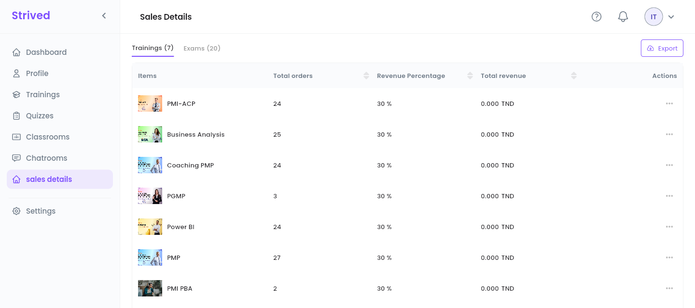
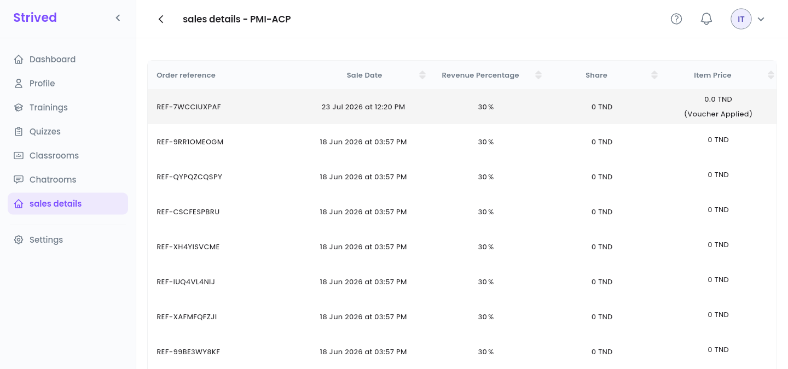

**sales details** in the sidebar lists everything you sell, with the orders behind each item and
your share. Your dashboard gives the totals; this page gives the detail.

<Note>
  Everything below is for the **web app** on a computer, signed in as an **Instructor**. Amounts are
  in Tunisian dinars (TND).
</Note>

---

## Table of contents

- **Step 1 — Open your sales**
- **Step 2 — See the orders of one item**
- **Step 3 — Export your sales**
- **Good to know**

---

## Step 1 — Open your sales

Click **sales details** in the sidebar. Two tabs list your items: **Trainings** and **Exams**, with
their count in brackets.

<Frame caption="sales details → Trainings.">
  
</Frame>

| Column | What it shows |
| :-- | :-- |
| **Items** | The training or exam. |
| **Total orders** | How many orders include it. |
| **Revenue Percentage** | Your share of each sale, set by an admin. |
| **Total revenue** | What you have earned on it. |

Click a column header to sort, for example by **Total orders** to see your best sellers.

---

## Step 2 — See the orders of one item

Open **⋯ → Preview** on a row.

<Frame caption="The orders of one training.">
  
</Frame>

Each row is one order: its **Order reference**, the **Sale Date**, your **Revenue Percentage**,
your **Share** in TND and the **Item Price** the learner paid. *(Voucher Applied)* under the price
means the learner got the item free with a voucher, so there is no share on that order.

---

## Step 3 — Export your sales

Click **Export** at the top right of **sales details**, then **As PDF** or **As CSV**. CSV opens in
Excel or Google Sheets.

---

## Good to know

<AccordionGroup>
  <Accordion title="Why is my share 0 on some orders?">
    The learner got the item for free: with a voucher, or at a price of 0 TND. Your share is a
    percentage of the price paid.
  </Accordion>
  <Accordion title="Who sets my revenue percentage?">
    An admin, per instructor. Once a training has sold, its percentage is locked so that past orders
    stay correct.
  </Accordion>
  <Accordion title="Where do I see my totals?">
    On your **Dashboard**: **Total revenue**, **Trainings Earnings** and **Exams Earnings**, with
    charts by week or month — see [Find your way around](/instructor-guide/get-started).
  </Accordion>
</AccordionGroup>
