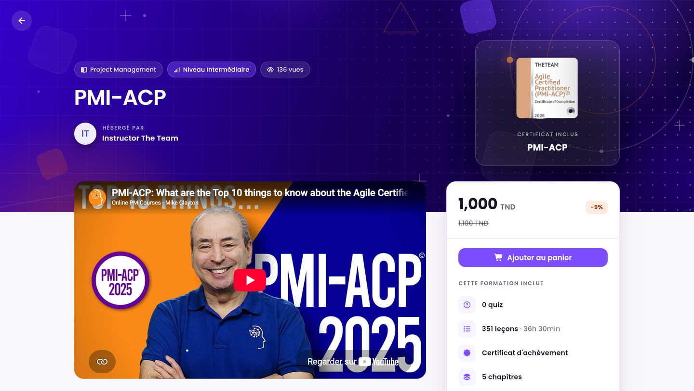
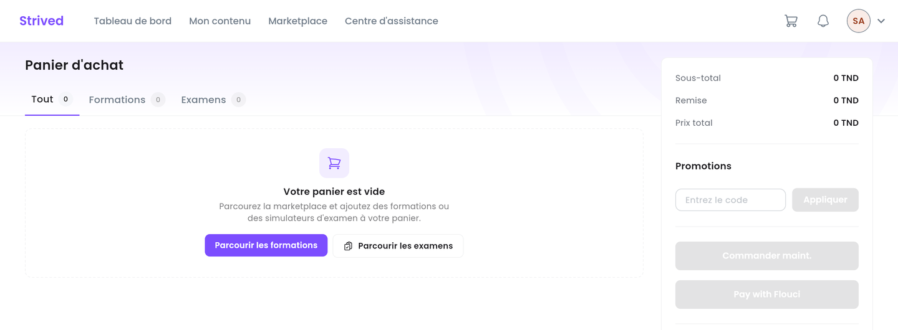

Ce guide vous montre comment trouver une formation ou un examen blanc sur la **Marketplace**, le
commander, puis le retrouver dans **Mon contenu**. Les prix sont en dinars tunisiens (TND).

<Note>
  Tout ce qui suit concerne l'**application web** sur ordinateur. Les formations et examens
  proposés dépendent de votre organisation.
</Note>

<Tip>
  Vous avez reçu un **voucher (bon)** par e-mail ? Il débloque vos formations et examens
  gratuitement, sans passer par le panier : voir [Utiliser un voucher](/student-guide/utiliser-un-voucher).
</Tip>

---

## Sommaire

- **Étape 1 — Parcourir la Marketplace**
- **Étape 2 — Consulter la fiche**
- **Étape 3 — Commander depuis le panier**
- **Étape 4 — Suivre votre commande**
- **Bon à savoir**

---

## Étape 1 — Parcourir la Marketplace

Cliquez sur **Marketplace** dans la barre du haut. Trois onglets s'affichent :
**Catalogue des formations**, **Catalogue des examens** et **Instructeurs**. Le bouton
**Filtres** affine la liste.

<Frame caption="Marketplace → Catalogue des formations.">
  
</Frame>

| Sur la carte | Signification |
| :-- | :-- |
| Bandeau **Achetée** | Vous possédez déjà cette formation : **Continuer** l'ouvre directement. |
| Prix, ex. `1,000 TND` | Le prix actuel ; le prix barré et le pourcentage indiquent une réduction. |
| **Visualiser** | Ouvre la fiche détaillée. |
| Icône panier | Ajoute la formation au panier. |

---

## Étape 2 — Consulter la fiche

<Frame caption="La fiche d'une formation : présentation à gauche, prix et contenu inclus à droite.">
  
</Frame>

La fiche présente la vidéo de présentation, la **Présentation de la formation**, le
**Contenu de la formation** (chapitres et leçons), le formateur et les **Avis des participants**.
Certaines leçons portent un bouton **Visualiser** : elles sont consultables gratuitement avant
l'achat. Les autres affichent un cadenas.

À droite, l'encadré rappelle le prix et ce que **Cette formation inclut** (quiz, leçons, durée,
certificat, chapitres, niveau). Cliquez sur **Ajouter au panier**.

---

## Étape 3 — Commander depuis le panier

Cliquez sur l'icône panier en haut à droite de l'écran.

<Frame caption="Le panier : vos articles à gauche, le récapitulatif et le paiement à droite.">
  
</Frame>

<Steps>
  <Step title="Vérifiez vos articles">
    Les onglets **Tout**, **Formations** et **Examens** trient le contenu du panier.
  </Step>
  <Step title="Appliquez un coupon (facultatif)">
    Si vous avez un **coupon** de réduction, saisissez son code dans **Promotions**, puis cliquez
    sur **Appliquer**. La **Remise** et le **Prix total** se mettent à jour.
  </Step>
  <Step title="Passez commande">
    Cliquez sur **Commander maint.** pour un paiement hors ligne : virement bancaire, paiement en
    personne dans nos bureaux, chèque, etc. Le paiement en ligne (**Pay with Flouci**) n'est pas
    encore disponible.
  </Step>
</Steps>

---

## Étape 4 — Suivre votre commande

Vos commandes sont listées dans **Paramètres → Archive des commandes**, avec leur référence, leur
prix, leur date et leur **Statut** :

| Statut | Signification |
| :-- | :-- |
| **En attente** | La commande est enregistrée et attend votre paiement. L'administration la valide dès réception. |
| **Payé hors ligne** / **Payé en ligne** | Le paiement est confirmé : la formation ou l'examen apparaît dans **Mon contenu**. |
| **Annulé** | La commande a été annulée. |

---

## Bon à savoir

<AccordionGroup>
  <Accordion title="Coupon ou voucher : quelle différence ?">
    Un **coupon** est un code de réduction : vous le saisissez dans le panier, dans **Promotions**,
    avant de commander. Les meilleurs apprenants du classement en gagnent. Un **voucher (bon)**
    débloque gratuitement un ensemble de formations et d'examens ; il arrive par e-mail et se saisit
    dans **Appliquer un bon** — voir [Utiliser un voucher](/student-guide/utiliser-un-voucher).
  </Accordion>
  <Accordion title="« Ces articles figurent déjà dans une commande… »">
    Une commande en attente contient déjà cet article. Retrouvez-la dans
    **Paramètres → Archive des commandes** et réglez-la, au lieu d'en créer une nouvelle.
  </Accordion>
  <Accordion title="« Vous ne pouvez pas ajouter cet article à votre panier, car il a été retiré de votre compte… »">
    Cette formation ou cet examen vous a été retiré par l'administration. Contactez le support
    depuis le **Centre d'assistance**.
  </Accordion>
  <Accordion title="Où retrouver ce que j'ai acheté ?">
    Dans **Mon contenu** : les formations dans **Mes formations**, les examens blancs dans
    **Mon simulateur d'examens**.
  </Accordion>
</AccordionGroup>
