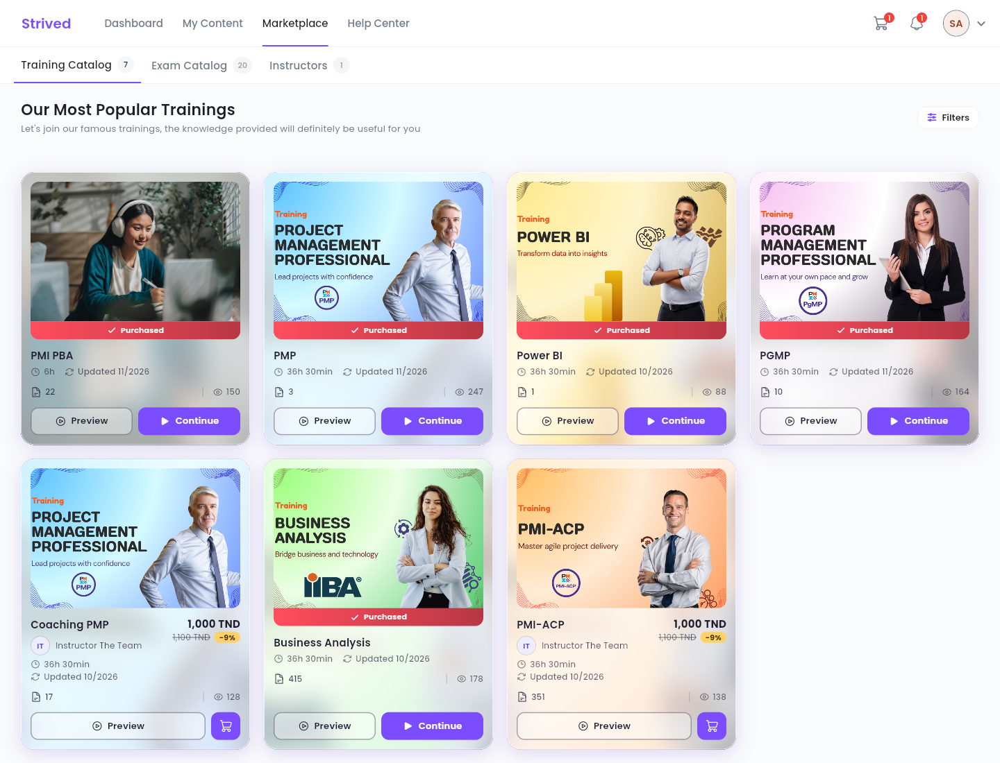
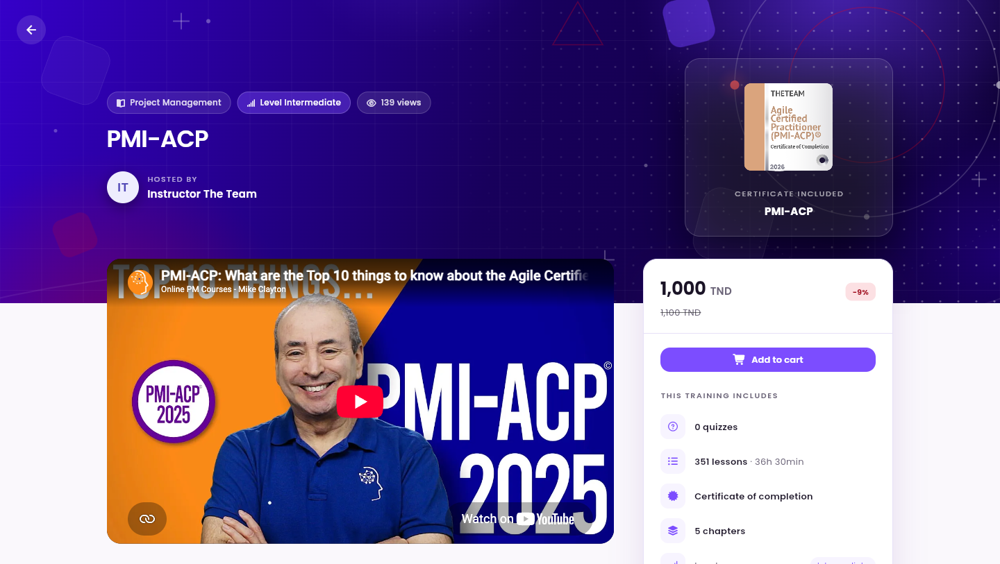
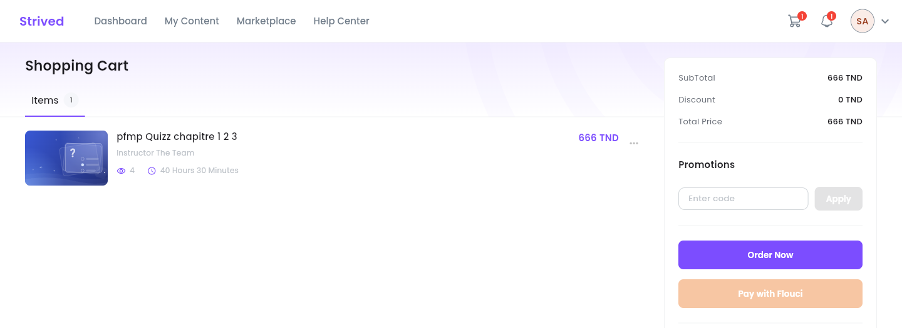
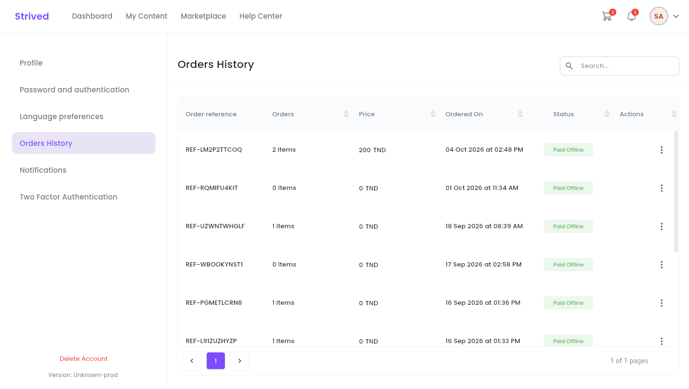

This guide shows you how to find a training or a mock exam in the **Marketplace**, order it, and
then find it in **My Content**. Prices are in Tunisian dinars (TND).

<Note>
  Everything below is for the **web app** on a computer. The trainings and exams on offer depend
  on your organization.
</Note>

<Tip>
  Did you receive a **voucher** by e-mail? It unlocks your trainings and exams for free, without
  going through the cart: see [Use a voucher](/student-guide/use-a-voucher).
</Tip>

---

## Table of contents

- **Step 1 — Browse the Marketplace**
- **Step 2 — Read the training's page**
- **Step 3 — Order from the cart**
- **Step 4 — Follow your order**
- **Good to know**

---

## Step 1 — Browse the Marketplace

Click **Marketplace** in the top bar. Three tabs show: **Training Catalog**, **Exam Catalog** and
**Instructors**. The **Filters** button narrows the list.

<Frame caption="Marketplace → Training Catalog.">
  
</Frame>

| On the card | Meaning |
| :-- | :-- |
| **Purchased** strip | You already own this training: **Continue** opens it straight away. |
| Price, e.g. `1,000 TND` | The current price; the crossed-out price and the percentage show a discount. |
| **Preview** | Opens the training's full page. |
| Cart icon | Adds the training to the cart. |

---

## Step 2 — Read the training's page

<Frame caption="A training's page: overview on the left, price and what is included on the right.">
  
</Frame>

The page shows the presentation video, the **Training Overview**, the **Training Content**
(chapters and lessons), the instructor and the **Participant Reviews**. Some lessons carry a
**Preview** button: you can watch them for free before you buy. The others show a padlock.

On the right, the box recalls the price and what **This training includes** (quizzes, lessons,
duration, certificate, chapters, level). Click **Add to cart**.

---

## Step 3 — Order from the cart

Click the cart icon at the top right of the screen.

<Frame caption="The cart: your items on the left, the summary and payment on the right.">
  
</Frame>

<Steps>
  <Step title="Check your items">
    The **Items** tab lists what is in your cart, with each price. The **⋯** menu on a row lets
    you remove it from the cart.
  </Step>
  <Step title="Apply a coupon (optional)">
    If you have a discount **coupon**, type its code in **Promotions**, then click **Apply**. The
    **Discount** and the **Total Price** update.
  </Step>
  <Step title="Place your order">
    Click **Order Now** to pay offline: bank transfer, payment in person at our offices, cheque,
    and so on. Online payment (**Pay with Flouci**) is not available yet.
  </Step>
</Steps>

---

## Step 4 — Follow your order

Your orders are listed in **Settings → Orders History** (avatar menu → **Settings**), with their
reference, number of items, price, date and **Status**:

<Frame caption="Settings → Orders History.">
  
</Frame>

| Status | Meaning |
| :-- | :-- |
| **Pending** | The order is saved and waiting for your payment. The administration confirms it as soon as the payment arrives. |
| **Pending Online** | An online payment was started but not confirmed yet. |
| **Paid Offline** / **Paid Online** | The payment is confirmed: the training or exam appears in **My Content**. |
| **Cancelled** | The order was cancelled. |

---

## Good to know

<AccordionGroup>
  <Accordion title="Coupon or voucher: what is the difference?">
    A **coupon** is a discount code: you type it in the cart, in **Promotions**, before ordering.
    The top learners of the leaderboard earn some. A **voucher** unlocks a set of trainings and
    exams for free; it arrives by e-mail and goes into **Apply voucher** — see
    [Use a voucher](/student-guide/use-a-voucher).
  </Accordion>
  <Accordion title="“You already have these items in an order that is Pending…”">
    A pending order already contains this item. Find it in **Settings → Orders History** and pay
    it, instead of creating a new one.
  </Accordion>
  <Accordion title="“You cannot add this item to your cart because it was previously unassigned from your account…”">
    The administration removed this training or exam from your account. Contact support from the
    **Help Center**.
  </Accordion>
  <Accordion title="Where do I find what I bought?">
    In **My Content**: trainings under **My Trainings**, mock exams under **My Exam Simulator**.
  </Accordion>
</AccordionGroup>
