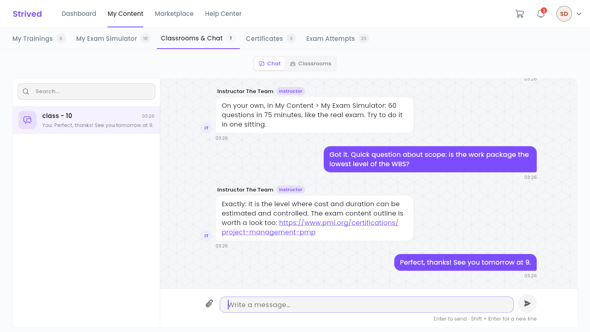
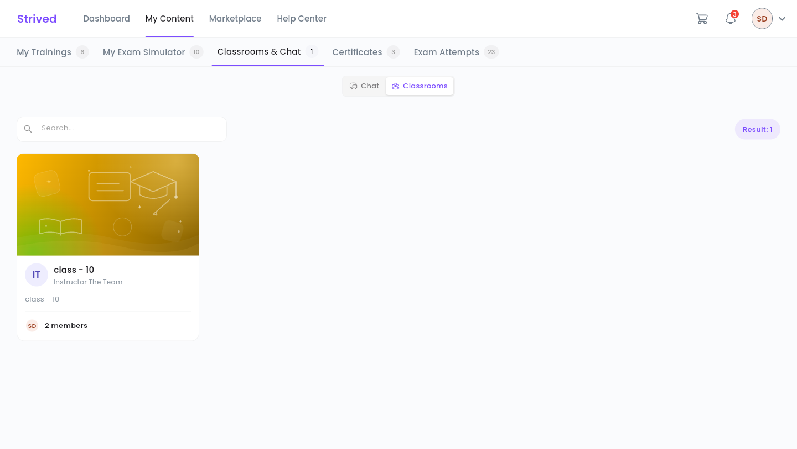
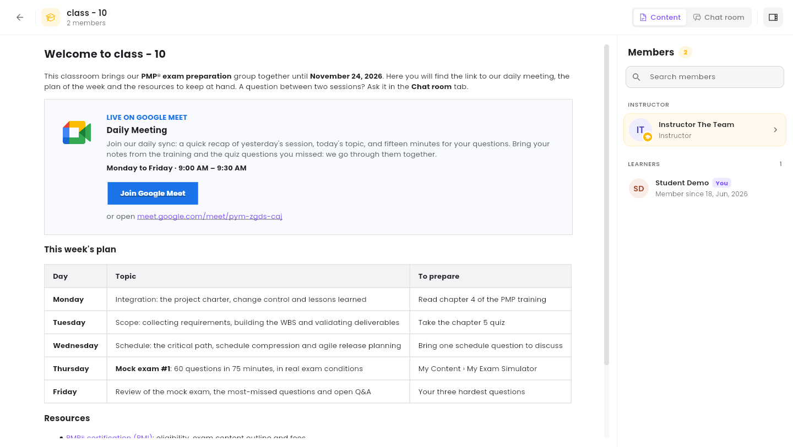

A **classroom** is your shared space with an instructor and a group of learners. Each classroom can
have its own **chat room**. This guide shows you where to find them and how to write.

<Note>
  Everything below is for the **web app** on a computer. Your organization adds you to classrooms:
  you cannot join one yourself.
</Note>

---

## Table of contents

- **Step 1 — Open Classrooms & Chat**
- **Step 2 — Chat in a chat room**
- **Step 3 — Open a classroom**
- **Good to know**

---

## Step 1 — Open Classrooms & Chat

Click **My Content**, then the **Classrooms & Chat** tab (address
`/student-my-content/classrooms`). Two buttons at the top of the page switch between the views:

- **Chat** — your chat rooms (the view that opens first);
- **Classrooms** — your classrooms.

---

## Step 2 — Chat in a chat room

<Frame caption="The Chat view: your chat rooms on the left, the conversation on the right.">
  
</Frame>

<Steps>
  <Step title="Pick a chat room">
    The list on the left shows your chat rooms and their latest message. The **Search…** box
    filters them by name.
  </Step>
  <Step title="Write your message">
    Type in **Write a message…**, then press **Enter** to send it. **Shift + Enter** starts a new
    line without sending.
  </Step>
  <Step title="Attach an image (optional)">
    Click the paperclip. Accepted formats: JPG, PNG, GIF or WEBP, up to 20 MB per image, 4 images
    per message.
  </Step>
</Steps>

<Callout type="info">
  The instructor and every learner of the classroom read the conversation: do not share anything
  personal there.
</Callout>

---

## Step 3 — Open a classroom

Click **Classrooms**. Each card shows the classroom's name, its instructor and its number of
members. The **Search…** box filters the cards.

<Frame caption="The Classrooms view: one card per classroom you belong to.">
  
</Frame>

Click a card to open the classroom:

<Frame caption="A classroom: its content on the left, its members on the right.">
  
</Frame>

| Item | What it holds |
| :-- | :-- |
| **Content** | The page your instructor writes for the group: the meeting link (**Join Google Meet** in the example above), the plan of the week, documents (PDFs, files), resources. |
| **Chat room** | The classroom's chat room, the same as in the **Chat** view. |
| **Members** panel | The instructor and the learners of the group. **Search members** finds someone; the button at the top right hides or shows the panel. |

If you do not belong to any classroom yet, the view shows **No classrooms yet**.

---

## Good to know

<AccordionGroup>
  <Accordion title="How do I know someone wrote to me?">
    The bell in the top bar shows your notifications: a new message in a chat room, being added to
    a classroom, and so on. **View All** opens the full list.
  </Accordion>
  <Accordion title="I cannot see my classroom">
    Your organization may not have added you yet. Contact your instructor, or support from the
    **Help Center**.
  </Accordion>
</AccordionGroup>
