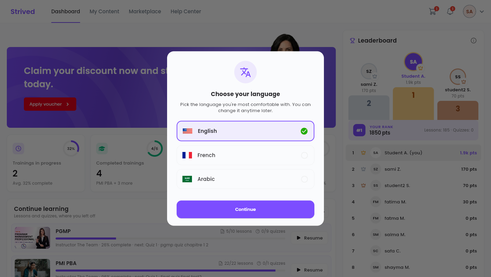
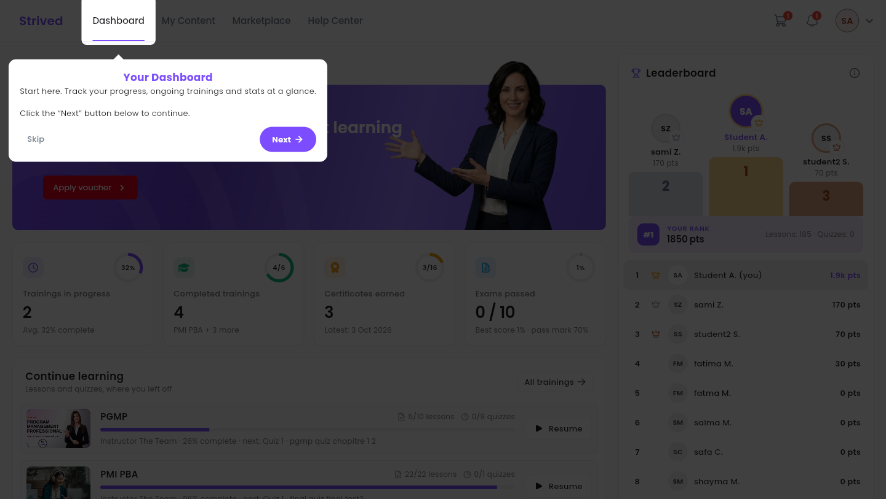
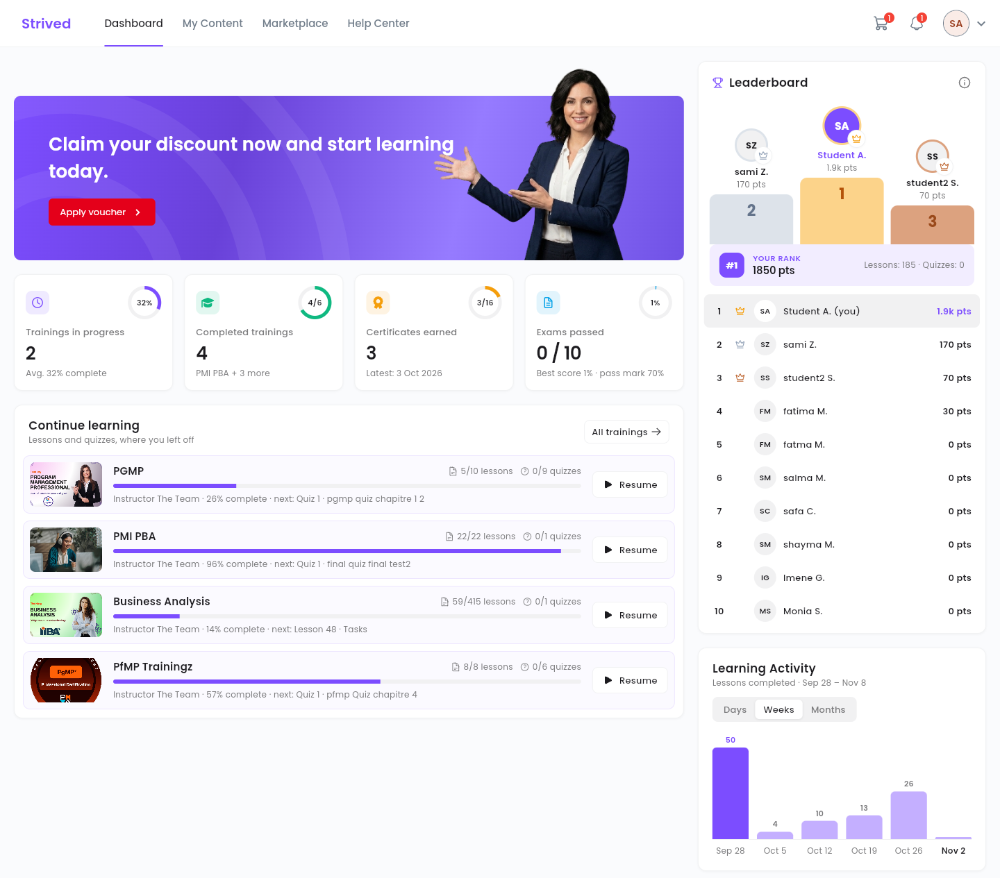
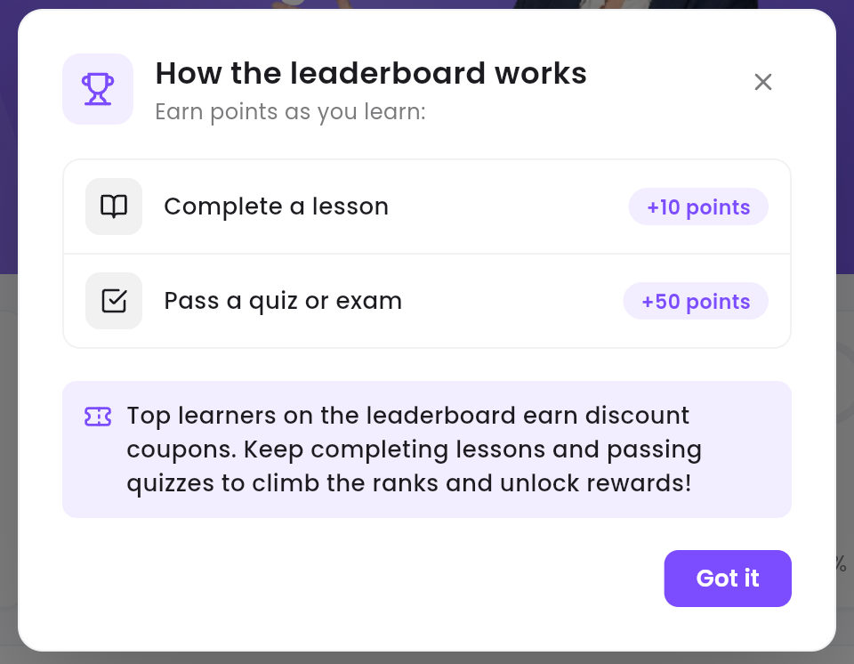

This guide walks you through your first login: choosing your language, the guided tour of the
app, and reading your **Dashboard**, the page that opens every time you log in.

<Note>
  Everything below is for the **web app** on a computer. On your screen you will see your own
  trainings, your own figures and your own rank.
</Note>

---

## Table of contents

- **Step 1 — Log in**
- **Step 2 — Choose your language**
- **Step 3 — Follow the guided tour**
- **Step 4 — Read your dashboard**
- **Step 5 — Earn points**
- **Good to know**

---

## Step 1 — Log in

<Steps>
  <Step title="Open the login page">
    The page title is **Login into your account**. The translation icon at the top right of the
    form changes the page language before you even log in.
  </Step>
  <Step title="Enter your details">
    Fill in your **Email** and **Password**, then click **Login**. Leave **Remember me** ticked to
    stay logged in on this computer.
  </Step>
</Steps>

<Tip>
  Forgot your password? Click **Forget Password**, next to **Remember me**.
</Tip>

---

## Step 2 — Choose your language

The very first time you log in, the **Choose your language** window opens. Select **English**,
**French** or **Arabic**, then click **Continue**. The whole app, guided tour included, then shows
in that language.

<Frame caption="The language window, on your first login.">
  
</Frame>

---

## Step 3 — Follow the guided tour

A short tour then presents the top bar, one item at a time: **Dashboard**, **My Content**,
**Marketplace** and **Help Center**. Click **Next** to move on, or **Skip** to stop it.

<Frame caption="The guided tour highlights each item of the top bar.">
  
</Frame>

The first time you open **My Content**, a second tour presents each of its tabs: **My Trainings**,
**My Exam Simulator**, **Classrooms & Chat**, **Certificates** and **Exam Attempts**. It ends with
**Got it**.

---

## Step 4 — Read your dashboard

<Frame caption="The dashboard: your figures, your trainings in progress, the leaderboard and your activity.">
  
</Frame>

| Area | What it shows you |
| :-- | :-- |
| **Apply voucher** banner | Enter the voucher you received by e-mail — see [Use a voucher](/student-guide/use-a-voucher). |
| **Trainings in progress** | How many trainings you have started, and their average completion. |
| **Completed trainings** | The trainings you have finished, out of all the ones you own. |
| **Certificates earned** | Your certificates and the date of the latest one. |
| **Exams passed** | The mock exams you have passed, your best score and the pass mark. |
| **Continue learning** | Your trainings, with the next lesson or quiz. **Resume** reopens a training where you left off; **Review** reopens a finished one. **All trainings** opens **My Trainings**. |
| **Leaderboard** | The learners of your organization, ranked by points, and **YOUR RANK**. |
| **Learning Activity** | The lessons you completed, by **Days**, **Weeks** or **Months**. |

---

## Step 5 — Earn points

Click the **ⓘ** icon of the **Leaderboard** to see how points are counted.

<Frame caption="How the leaderboard points work.">
  
</Frame>

- **Complete a lesson**: +10 points.
- **Pass a quiz or exam**: +50 points.

The top learners on the leaderboard earn discount coupons, which you can use in the cart.

---

## Good to know

<AccordionGroup>
  <Accordion title="Can I see the guided tour again?">
    The tour only shows once per account on the same browser. The guides in this section and the
    **Help Center** stay available at any time.
  </Accordion>
  <Accordion title="How do I change the language later?">
    Click your avatar at the top right, then **Languages**. See
    [Manage your account](/student-guide/manage-your-account).
  </Accordion>
  <Accordion title="My dashboard is empty">
    You do not own any training yet. If you received a voucher by e-mail, enter it with
    **Apply voucher** — see [Use a voucher](/student-guide/use-a-voucher). Otherwise, browse the
    **Marketplace**.
  </Accordion>
</AccordionGroup>
