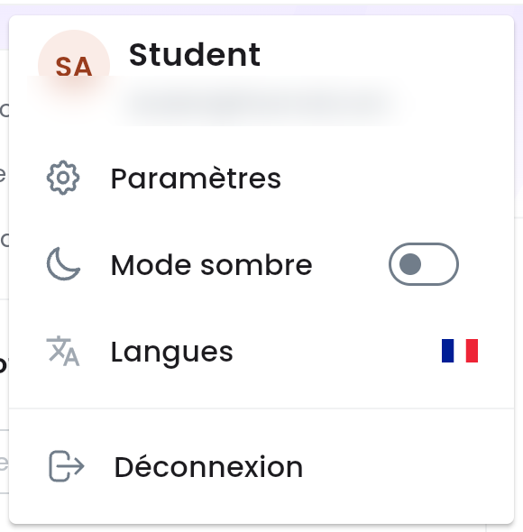
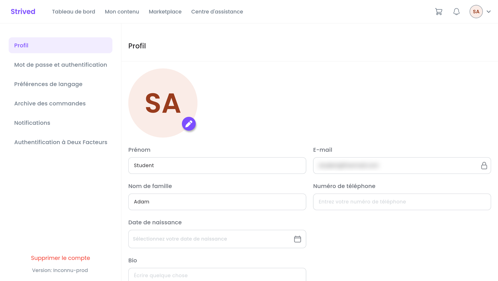
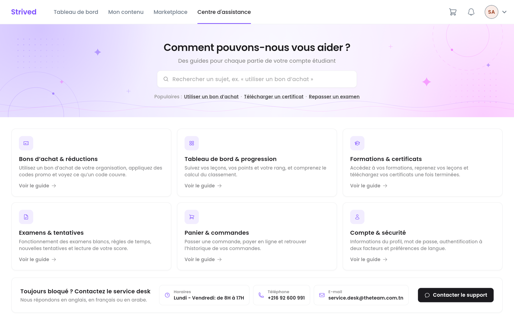

Ce guide fait le tour de vos réglages personnels et vous montre où trouver de l'aide.

<Note>
  Tout ce qui suit concerne l'**application web** sur ordinateur.
</Note>

---

## Sommaire

- **Étape 1 — Ouvrir le menu de votre avatar**
- **Étape 2 — Modifier votre profil**
- **Étape 3 — Les autres réglages**
- **Étape 4 — Activer la double authentification**
- **Étape 5 — Obtenir de l'aide**
- **Bon à savoir**

---

## Étape 1 — Ouvrir le menu de votre avatar

Cliquez sur votre avatar (vos initiales) en haut à droite de l'écran.

<Frame caption="Le menu de l'avatar.">
  
</Frame>

| Élément | Rôle |
| :-- | :-- |
| **Paramètres** | Ouvre vos réglages : profil, mot de passe, commandes, etc. |
| **Mode sombre** | Active ou désactive le thème sombre. |
| **Langues** | Passe l'application en anglais, en français ou en arabe. |
| **Déconnexion** | Ferme votre session sur cet ordinateur. |

---

## Étape 2 — Modifier votre profil

Cliquez sur **Paramètres**. La section **Profil** s'ouvre par défaut.

<Frame caption="Paramètres → Profil.">
  
</Frame>

<Steps>
  <Step title="Changez votre photo (facultatif)">
    Cliquez sur le crayon violet en bas de votre photo.
  </Step>
  <Step title="Complétez vos informations">
    **Prénom**, **Nom de famille**, **Numéro de téléphone**, **Date de naissance** et **Bio**.
    L'**E-mail** (cadenas) ne peut pas être modifié.
  </Step>
  <Step title="Enregistrez">
    Cliquez sur **Modifier le profil** en bas de la page.
  </Step>
</Steps>

---

## Étape 3 — Les autres réglages

Le menu de gauche de **Paramètres** donne accès aux autres sections :

| Section | Ce que vous y faites |
| :-- | :-- |
| **Mot de passe et authentification** | Changer votre mot de passe : **Mot de passe actuel**, **Nouveau mot de passe**, confirmation, puis **Enregistrer**. |
| **Préférences de langage** | Choisir **Anglais**, **Français** ou **Arabe**. |
| **Archive des commandes** | Retrouver vos commandes et leur statut — voir [Acheter une formation ou un examen](/student-guide/acheter-une-formation). |
| **Notifications** | Relire toutes vos notifications (messages de salon, ajout à une classe, etc.). |
| **Authentification à Deux Facteurs** | Protéger votre compte avec un code à 6 chiffres (étape 4). |
| **Supprimer le compte** | Supprimer définitivement votre compte, après confirmation. |

<Warning>
  La suppression du compte est **permanente** et ne peut pas être annulée : vous perdez l'accès à
  vos formations, examens et certificats.
</Warning>

---

## Étape 4 — Activer la double authentification

Ouvrez **Paramètres → Authentification à Deux Facteurs**, puis suivez les étapes affichées :

<Steps>
  <Step title="Installez Google Authenticator sur votre téléphone">
    L'application est disponible sur l'App Store et Google Play.
  </Step>
  <Step title="Ouvrez l'application">
    Appuyez sur **+**, puis sur **Scanner un code QR**.
  </Step>
  <Step title="Scannez le code QR">
    Cliquez sur **Appuyez pour révéler le code QR**, puis scannez-le avec votre téléphone.
  </Step>
  <Step title="Saisissez le code à 6 chiffres">
    Tapez le code affiché par Google Authenticator, puis cliquez sur **Activer**.
  </Step>
</Steps>

<Tip>
  Ne montrez jamais votre code QR à quelqu'un : il permet de générer vos codes de connexion.
</Tip>

---

## Étape 5 — Obtenir de l'aide

Cliquez sur **Centre d'assistance** dans la barre du haut.

<Frame caption="Le Centre d'assistance : recherche, sujets et coordonnées du service desk.">
  
</Frame>

- Le champ de recherche et les liens **Populaires** mènent directement aux sujets fréquents.
- Six sujets regroupent l'aide par thème : vouchers et coupons, tableau de bord, formations et
  certificats, examens, panier et commandes, compte et sécurité. **Voir le guide** ouvre les
  vidéos explicatives.
- Le bandeau **Toujours bloqué ?** donne les horaires, le téléphone et l'e-mail du service desk.
  **Contacter le support** ouvre un e-mail prêt à envoyer. Le support répond en anglais, en
  français ou en arabe.

---

## Bon à savoir

<AccordionGroup>
  <Accordion title="Comment changer mon adresse e-mail ?">
    L'e-mail sert d'identifiant et ne peut pas être modifié depuis l'application. Contactez le
    support.
  </Accordion>
  <Accordion title="Où voir mes notifications ?">
    La cloche de la barre du haut affiche les dernières ; **Voir tout** ouvre la liste complète
    (**Paramètres → Notifications**).
  </Accordion>
</AccordionGroup>
