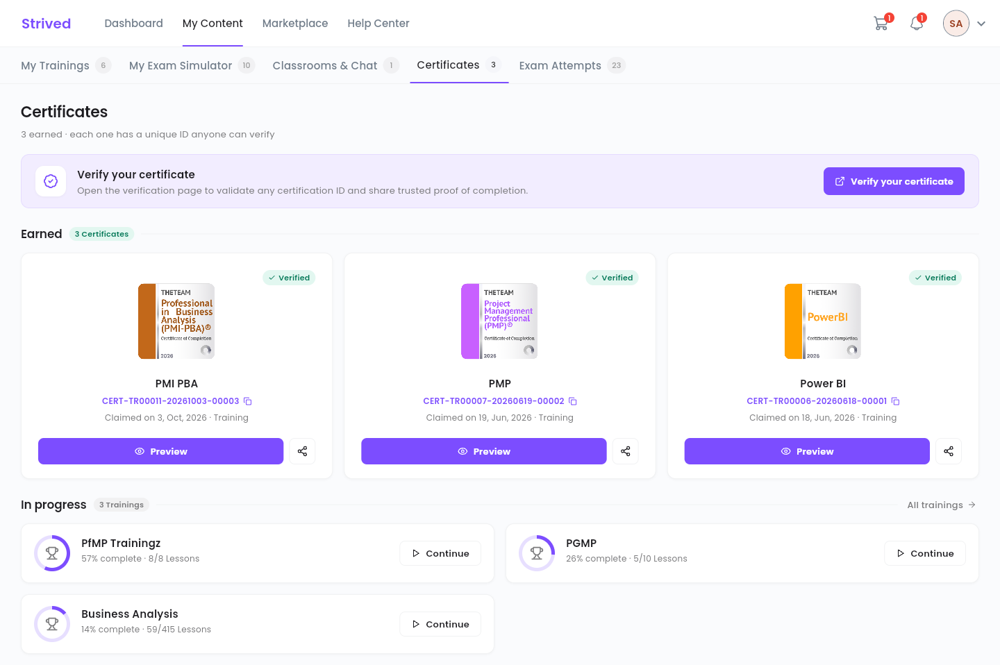

Every training you complete earns you a certificate of completion. This guide shows you where to
find it, how to download it and how to prove it is genuine.

<Note>
  Everything below is for the **web app** on a computer. You will see your own certificates.
</Note>

---

## Table of contents

- **Step 1 — Unlock the certificate**
- **Step 2 — Open the Certificates tab**
- **Step 3 — Preview, download or print**
- **Step 4 — Share it and have it verified**
- **Good to know**

---

## Step 1 — Unlock the certificate

A certificate unlocks once you have completed **all** the lessons and passed **all** the quizzes of
a training. Follow your progress with the medal chip of the course player — see
[Follow a training](/student-guide/study-a-training), step 6.

Once everything is done, the training's card in **My Trainings** shows **View certificate**.

---

## Step 2 — Open the Certificates tab

Click **My Content**, then the **Certificates** tab (address
`/student-my-content/certifications`).

<Frame caption="My Content → Certificates: the certificates you have earned and your trainings in progress.">
  
</Frame>

| Item | Meaning |
| :-- | :-- |
| **Verified** chip | The certificate is genuine and can be checked online. |
| `CERT-…` + copy icon | The certificate's unique ID. Click the icon to copy it. |
| **Claimed on …** | The date you earned it. |
| **Preview** | Opens the certificate in a new tab. |
| Share icon | Copies the certificate's public link. |
| **In progress** section | Your trainings not finished yet, with **Continue**. **All trainings** opens **My Trainings**. |

---

## Step 3 — Preview, download or print

Click **Preview**. The certificate page opens in a new tab, with its details (name, training,
duration, date, ID) and four buttons:

| Button | What it does |
| :-- | :-- |
| **Copy Certif ID** | Copies the certificate ID. |
| **Download Certificate** | Downloads the certificate. |
| **Share to LinkedIn** | Shares the certificate on LinkedIn. |
| **Print PDF** | Prints the certificate or saves it as a PDF. |

---

## Step 4 — Share it and have it verified

- **Share**: click the share icon on a card. The certificate's public link is copied; paste it into
  an e-mail or a message. Anyone who opens it sees the certificate.
- **Have it verified**: the **Verify your certificate** button opens the verification page. An
  employer can enter the `CERT-…` ID there to confirm the certificate is genuine.

---

## Good to know

<AccordionGroup>
  <Accordion title="I completed every lesson, but there is no certificate">
    Check the quizzes: the certificate also needs **all** the quizzes of the training to be
    passed. The certificate progress window, in the course player, shows what you still have to
    do.
  </Accordion>
  <Accordion title="My name is misspelled on the certificate">
    The certificate uses the first name and last name of your profile
    (see [Manage your account](/student-guide/manage-your-account)). To correct a certificate that
    has already been issued, contact support from the **Help Center**.
  </Accordion>
</AccordionGroup>
