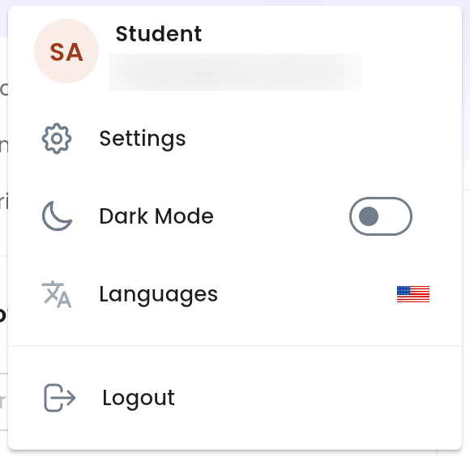
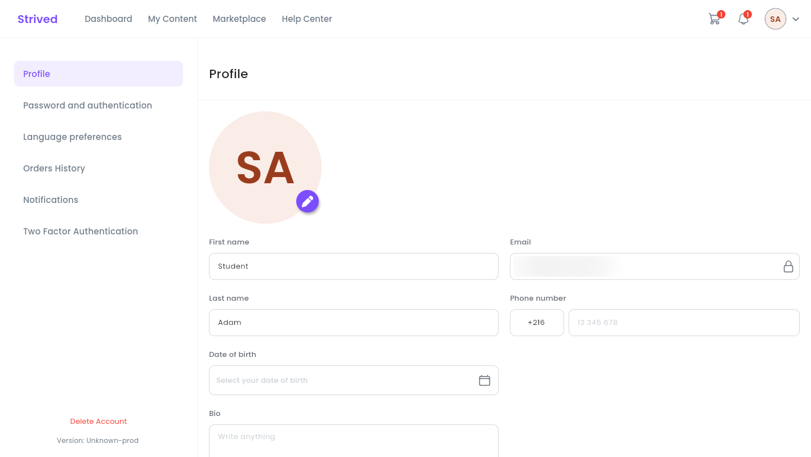
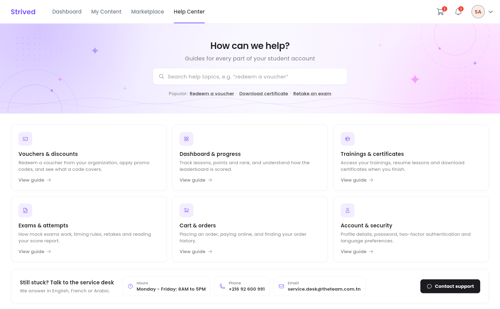

This guide goes through your personal settings and shows you where to find help.

<Note>
  Everything below is for the **web app** on a computer.
</Note>

---

## Table of contents

- **Step 1 — Open your avatar menu**
- **Step 2 — Edit your profile**
- **Step 3 — The other settings**
- **Step 4 — Turn on two-factor authentication**
- **Step 5 — Get help**
- **Good to know**

---

## Step 1 — Open your avatar menu

Click your avatar (your initials) at the top right of the screen.

<Frame caption="The avatar menu.">
  
</Frame>

| Item | What it does |
| :-- | :-- |
| **Settings** | Opens your settings: profile, password, orders, and so on. |
| **Dark Mode** | Turns the dark theme on or off. |
| **Languages** | Switches the app to English, French or Arabic. |
| **Logout** | Ends your session on this computer. |

---

## Step 2 — Edit your profile

Click **Settings**. The **Profile** section opens first.

<Frame caption="Settings → Profile.">
  
</Frame>

<Steps>
  <Step title="Change your photo (optional)">
    Click the purple pencil at the bottom of your photo.
  </Step>
  <Step title="Fill in your details">
    **First name**, **Last name**, **Phone number** (pick the country code, then type the number),
    **Date of birth** and **Bio**. The **Email** (padlock) cannot be changed.
  </Step>
  <Step title="Save">
    Click **Update profile** at the bottom of the page.
  </Step>
</Steps>

---

## Step 3 — The other settings

The left-hand menu of **Settings** leads to the other sections:

| Section | What you do there |
| :-- | :-- |
| **Password and authentication** | Change your password: **Current Password**, **New Password**, **Confirm New Password**, then **Save**. |
| **Language preferences** | Choose **English**, **French** or **Arabic**. |
| **Orders History** | Find your orders and their status — see [Buy a training or an exam](/student-guide/buy-a-training). |
| **Notifications** | Read all your notifications again (chat room messages, being added to a classroom, and so on). |
| **Two Factor Authentication** | Protect your account with a 6-digit code (step 4). |
| **Delete Account** (red link at the bottom) | Delete your account for good, after a confirmation. |

<Warning>
  Deleting your account is **permanent** and cannot be undone: you lose access to your trainings,
  exams and certificates.
</Warning>

---

## Step 4 — Turn on two-factor authentication

Open **Settings → Two Factor Authentication**, then follow the steps on screen:

<Steps>
  <Step title="Install Google Authenticator on your phone">
    The app is available on the App Store and Google Play.
  </Step>
  <Step title="Open the app">
    Tap **+**, then **Scan QR Code**.
  </Step>
  <Step title="Scan the QR code and save your recovery code">
    Click **Tap To Reveal QR Code**, then scan it with your phone. Keep the recovery code shown
    with it (**Download Recovery Codes**): without it, your account cannot be recovered if you lose
    access to your authenticator app.
  </Step>
  <Step title="Enter the 6-digit code">
    Type the code Google Authenticator shows, then click **Activate**.
  </Step>
</Steps>

<Tip>
  Never show your QR code or your recovery code to anyone: they let someone generate your login
  codes.
</Tip>

---

## Step 5 — Get help

Click **Help Center** in the top bar.

<Frame caption="The Help Center: search, topics and the service desk's details.">
  
</Frame>

- The search box and the **Popular:** links take you straight to frequent topics.
- Six topics group the help by theme: **Vouchers & discounts**, **Dashboard & progress**,
  **Trainings & certificates**, **Exams & attempts**, **Cart & orders** and
  **Account & security**. **View guide** opens the explainer videos.
- The **Still stuck? Talk to the service desk** banner gives the service desk's hours, phone
  number and e-mail. **Contact support** opens an e-mail ready to send. Support answers in
  English, French or Arabic.

---

## Good to know

<AccordionGroup>
  <Accordion title="How do I change my e-mail address?">
    Your e-mail is your login and cannot be changed from the app. Contact support.
  </Accordion>
  <Accordion title="Where do I see my notifications?">
    The bell in the top bar shows the latest ones; **View All** opens the full list
    (**Settings → Notifications**).
  </Accordion>
</AccordionGroup>
