Strived is also an app for iPhone and Android. This guide goes through its screens tab by tab, so
you know where everything is on your phone. You log in with the same account as on the web, and your
progress follows you from one device to the other.

<Note>
  The screenshots come from an iPhone, on the test platform, so your trainings and figures will be
  different. The Android app has the same tabs.
</Note>

---

## Table of contents

- **Step 1 — Install the app and log in**
- **Step 2 — Find your way around**
- **Step 3 — Read your dashboard**
- **Step 4 — Open your trainings, exams and certificates**
- **Step 5 — Join your classrooms**
- **Step 6 — Browse the Marketplace**
- **Step 7 — Get help and change your settings**
- **Good to know**

---

## Step 1 — Install the app and log in

<Steps>
  <Step title="Install Strived">
    Get the app from the App Store on an iPhone, or from Google Play on an Android phone. Both
    buttons are on the [Presentation](/#strived-on-the-phone) page.
  </Step>
  <Step title="Follow the welcome tour">
    The first time the app opens, a short tour asks for your language (English, French or Arabic)
    and shows what Strived prepares you for.
  </Step>
  <Step title="Log in">
    Fill in your **Email** and **Password**, then tap **Login**. New to Strived? Tap **Create an
    account**. Forgot your password? Tap **Forget Password**.
  </Step>
</Steps>

<Columns cols={3}>
  <Frame caption="The tour starts with your language.">
    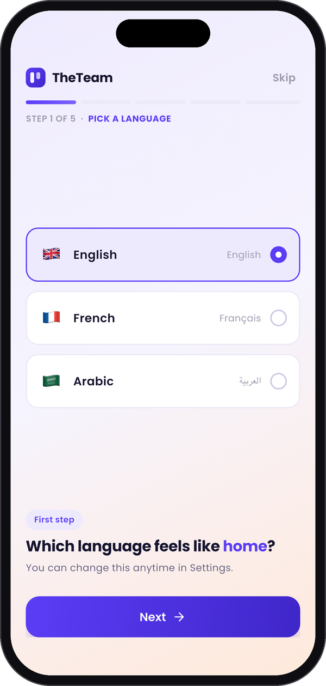
  </Frame>
  <Frame caption="It shows what you can get certified in.">
    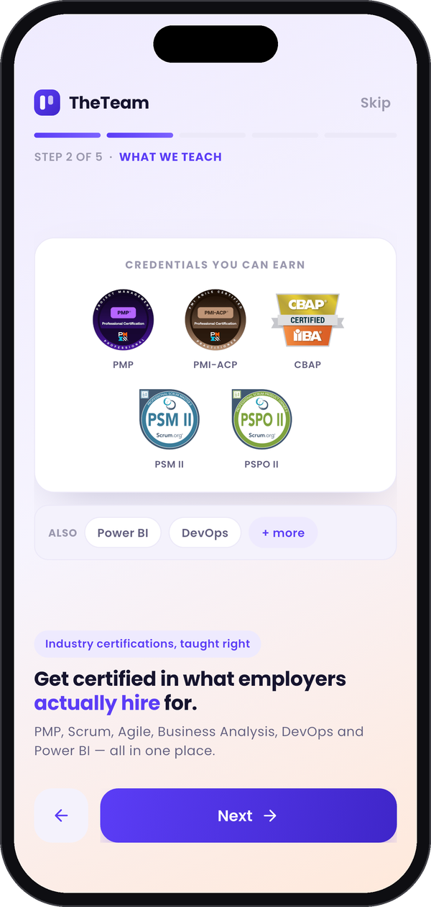
  </Frame>
  <Frame caption="Then you log in.">
    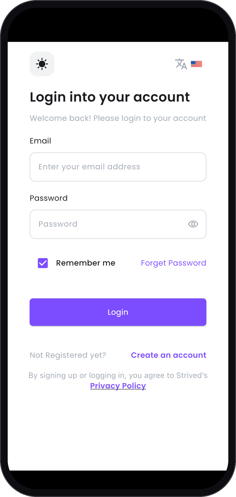
  </Frame>
</Columns>

---

## Step 2 — Find your way around

The bar at the bottom of the screen has five tabs:

| Tab | What you find there |
| :-- | :-- |
| **Dashboard** | Your progress, your trainings in progress and the leaderboard. |
| **My Content** | Your trainings, exams, classrooms and chat, certificates and exam attempts. |
| **Marketplace** | The trainings, exams and instructors of the catalog. |
| **Help Center** | The help guides and the service desk's contact details. |
| **Settings** | Your profile, password, two-factor authentication, language, dark mode and notifications. |

The header at the top stays the same on every tab: your avatar opens **Settings**, the cart icon
opens your **Shopping Cart** and the bell opens your **Notifications**.

---

## Step 3 — Read your dashboard

**Dashboard** is the screen that opens when you log in. From top to bottom:

- **Apply voucher**, on the purple banner, redeems a voucher you received by e-mail. See
  [Use a voucher](/student-guide/use-a-voucher).
- Four cards give your figures: **Trainings in progress**, **Completed trainings**, **Certificates
  earned** and **Exams passed**.
- **Continue learning** lists your trainings. **Resume** takes you back where you left off.
- **Leaderboard** shows your rank and points among the other learners.

Tap the bell at the top right to read your **Notifications**: your orders, your classroom messages
and the news from your instructors.

<Columns cols={3}>
  <Frame caption="The top of the dashboard.">
    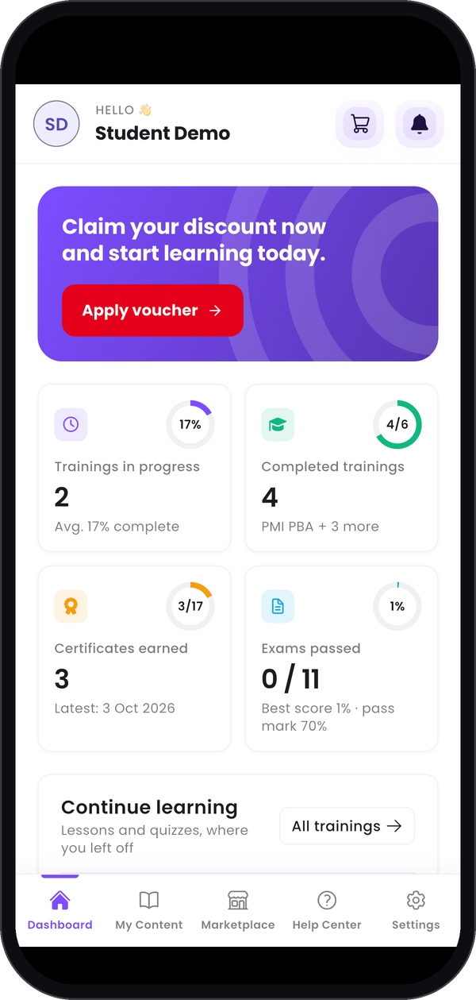
  </Frame>
  <Frame caption="The leaderboard, further down.">
    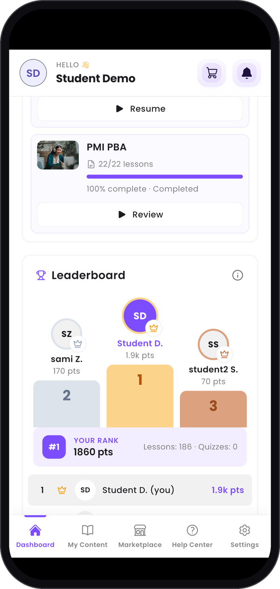
  </Frame>
  <Frame caption="Your notifications.">
    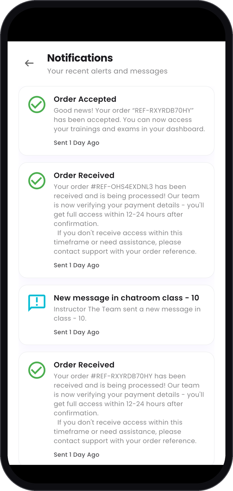
  </Frame>
</Columns>

---

## Step 4 — Open your trainings, exams and certificates

**My Content** gathers everything you own. Swipe the row of tabs at the top to see them all:

| Tab | What you do there |
| :-- | :-- |
| **My Trainings** | Follow your progress. **Continue** opens the lesson where you stopped, **Review** goes back through a finished training, **View certificate** opens the certificate you earned. |
| **My Exams** | Find your exams, grouped by category. The app recommends taking them on the web (see **Good to know**). |
| **Classrooms & Chat** | Join your classrooms and their chat: see **Step 5**. |
| **Certificates** | Copy the unique ID of each certificate, **Preview** it, or open the page that verifies it with **Verify your certificate**. |
| **Exam Attempts** | Find every attempt, grouped by exam or date if you like, and tap **Review** to go through it. |

<Columns cols={3}>
  <Frame caption="My Trainings.">
    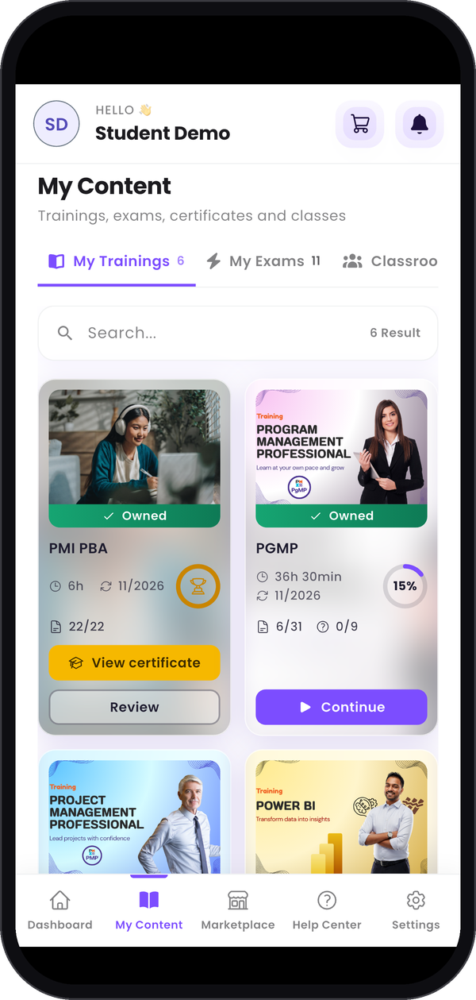
  </Frame>
  <Frame caption="My Exams.">
    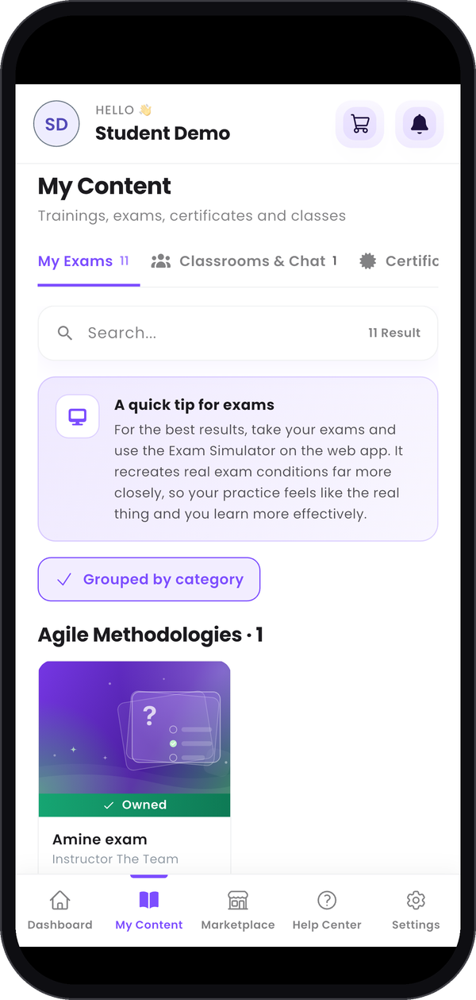
  </Frame>
  <Frame caption="Certificates.">
    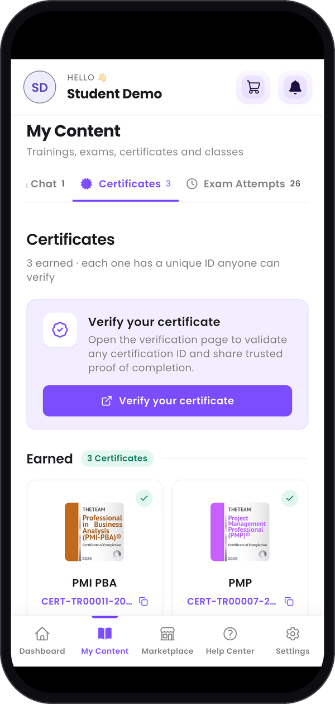
  </Frame>
  <Frame caption="Exam Attempts.">
    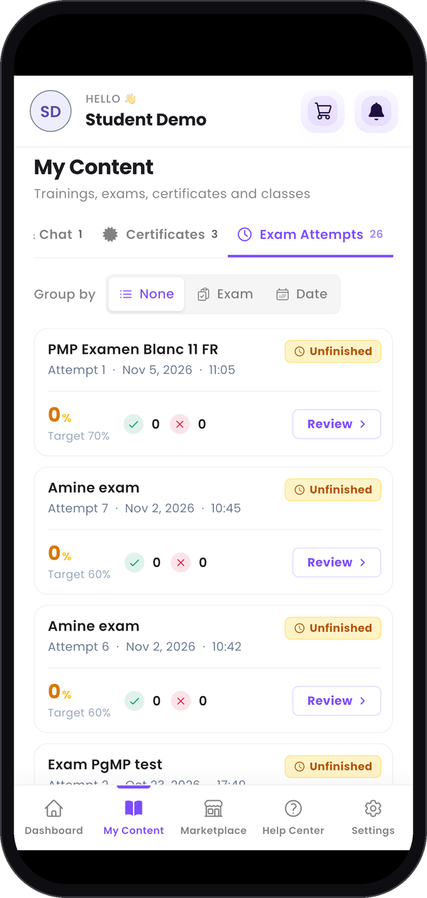
  </Frame>
</Columns>

---

## Step 5 — Join your classrooms

In **My Content**, open the **Classrooms & Chat** tab. Two buttons switch the view:

- **Chat** lists the chat rooms of your classrooms, with their last message. Tap one to read it and
  write to your group.
- **Classrooms** lists your classrooms. Tap one to open its page, with the instructor's content
  (live-session link, plan, resources), and **Chat room** to go to its chat.

<Columns cols={3}>
  <Frame caption="Your chat rooms.">
    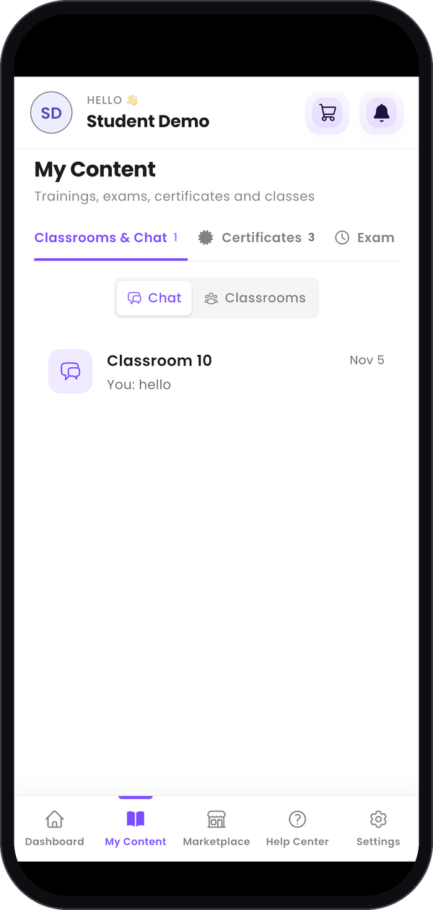
  </Frame>
  <Frame caption="A classroom's page.">
    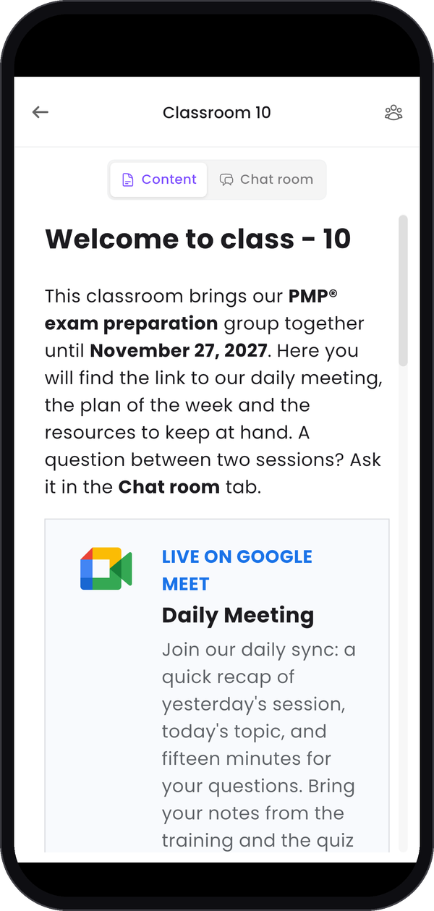
  </Frame>
  <Frame caption="A conversation with your instructor.">
    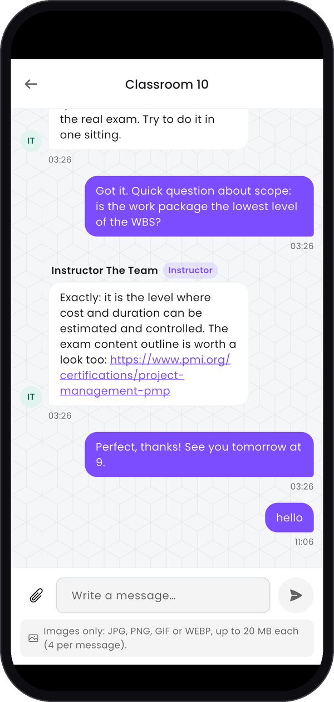
  </Frame>
</Columns>

---

## Step 6 — Browse the Marketplace

**Marketplace** has three tabs: **Trainings**, **Exams** and **Instructors**. Use **Search...** and
**Filters** to narrow the list, then **Preview** a training or **Add to cart**.

The cart icon in the header opens your **Shopping Cart**, where **Coupon** applies a discount code.
The order then goes the same way as on the web: see
[Buy a training or an exam](/student-guide/buy-a-training).

<Columns cols={3}>
  <Frame caption="The Marketplace.">
    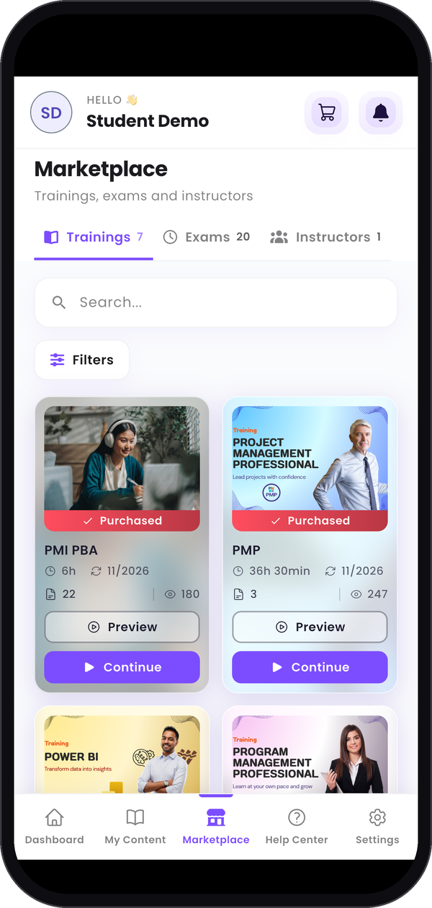
  </Frame>
  <Frame caption="Your Shopping Cart.">
    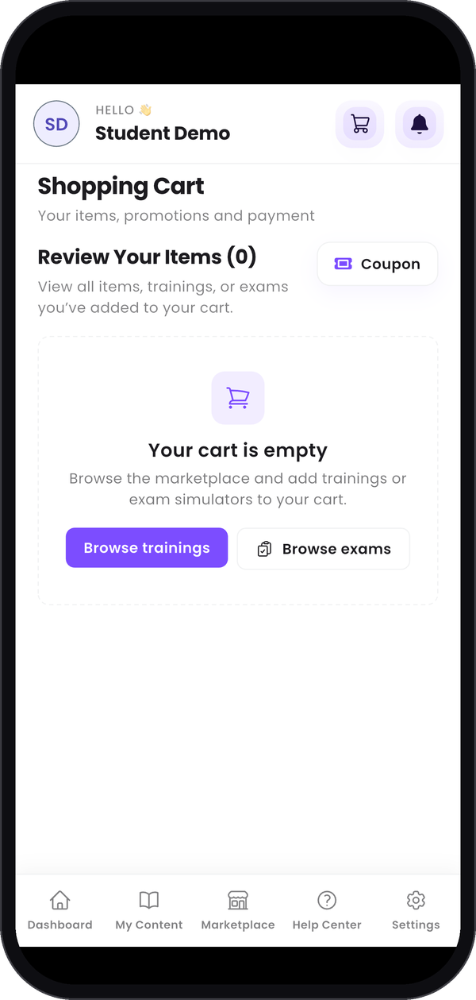
  </Frame>
</Columns>

---

## Step 7 — Get help and change your settings

**Help Center** gathers the help guides by topic. Search them, or scroll down to **Still stuck? Talk
to the service desk** for its hours, phone number and e-mail address.

**Settings** holds your account: **Edit Profile**, **Change Password**, **Setup Two Factor
Authentication**, **Language preferences**, **Dark Mode** and **Notifications**. Scroll down for
**Logout**. See [Manage your account](/student-guide/manage-your-account) for the details.

<Columns cols={3}>
  <Frame caption="The Help Center.">
    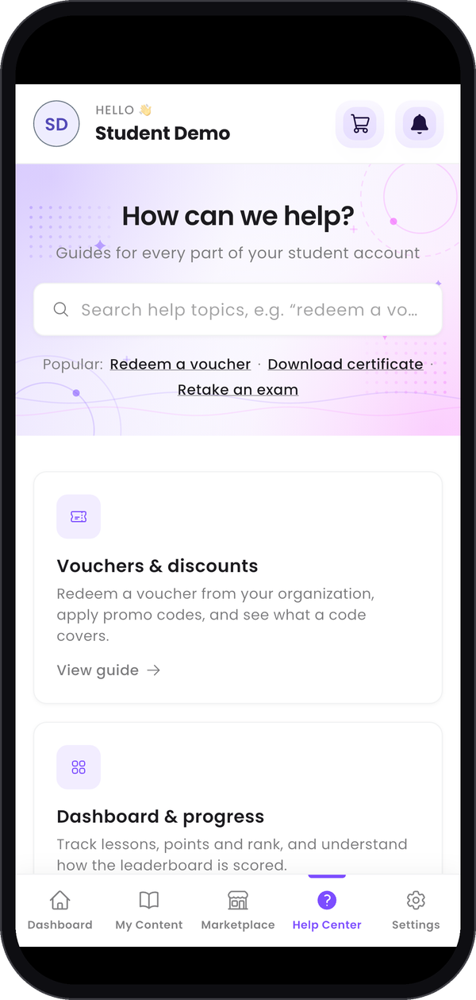
  </Frame>
  <Frame caption="Your settings.">
    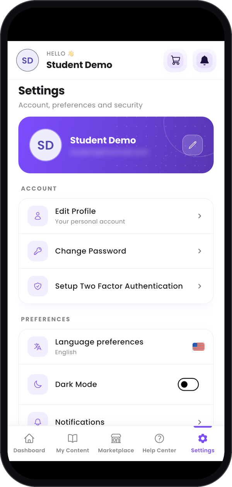
  </Frame>
</Columns>

---

## Good to know

<AccordionGroup>
  <Accordion title="Does my progress follow me from the phone to the web?">
    Yes. It is the same account on both, so your lessons, certificates and exam attempts are the
    same wherever you log in.
  </Accordion>
  <Accordion title="Can I take my exams on the phone?">
    The app recommends the web. **A quick tip for exams**, at the top of **My Exams**, says why: the
    Exam Simulator on the web recreates real exam conditions far more closely.
  </Accordion>
  <Accordion title="How do I change the language of the app?">
    In **Settings**, tap **Language preferences**.
  </Accordion>
  <Accordion title="Do the other guides work on the phone?">
    They follow the web app on a computer, so their screenshots look different from the app. Use this
    page to find the right tab.
  </Accordion>
</AccordionGroup>
