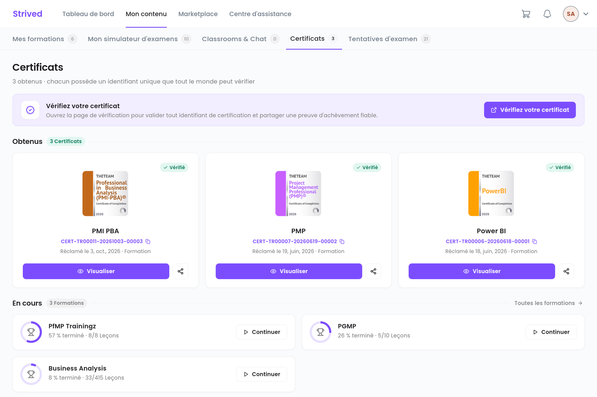

Chaque formation terminée vous donne droit à un certificat d'achèvement. Ce guide vous montre où le
trouver, comment le télécharger et comment prouver qu'il est authentique.

<Note>
  Tout ce qui suit concerne l'**application web** sur ordinateur. Vous verrez vos propres
  certificats.
</Note>

---

## Sommaire

- **Étape 1 — Débloquer le certificat**
- **Étape 2 — Ouvrir l'onglet Certificats**
- **Étape 3 — Visualiser, télécharger ou imprimer**
- **Étape 4 — Partager et faire vérifier**
- **Bon à savoir**

---

## Étape 1 — Débloquer le certificat

Un certificat se débloque quand vous avez terminé **toutes** les leçons et réussi **tous** les quiz
d'une formation. Suivez votre avancement avec la pastille médaille du lecteur de cours — voir
[Suivre une formation](/student-guide/suivre-une-formation), étape 6.

Une fois tout terminé, la carte de la formation dans **Mes formations** affiche
**Voir le certificat**.

---

## Étape 2 — Ouvrir l'onglet Certificats

Cliquez sur **Mon contenu**, puis sur l'onglet **Certificats** (adresse
`/student-my-content/certifications`).

<Frame caption="Mon contenu → Certificats : vos certificats obtenus et vos formations en cours.">
  
</Frame>

| Élément | Signification |
| :-- | :-- |
| Pastille **Vérifié** | Le certificat est authentique et vérifiable en ligne. |
| `CERT-…` + icône copier | L'identifiant unique du certificat. Cliquez sur l'icône pour le copier. |
| **Réclamé le …** | La date d'obtention. |
| **Visualiser** | Ouvre le certificat dans un nouvel onglet. |
| Icône partager | Copie le lien public du certificat. |
| Section **En cours** | Vos formations pas encore terminées, avec **Continuer**. |

---

## Étape 3 — Visualiser, télécharger ou imprimer

Cliquez sur **Visualiser**. La page du certificat s'ouvre dans un nouvel onglet, avec ses détails
(nom, formation, durée, date, identifiant) et quatre boutons :

| Bouton | Rôle |
| :-- | :-- |
| **Copy Certif ID** | Copie l'identifiant du certificat. |
| **Download Certificate** | Télécharge le certificat. |
| **Share to LinkedIn** | Partage le certificat sur LinkedIn. |
| **Print PDF** | Imprime le certificat ou l'enregistre en PDF. |

<Note>
  Cette page est pour l'instant affichée en anglais, quelle que soit la langue choisie dans
  l'application.
</Note>

---

## Étape 4 — Partager et faire vérifier

- **Partager** : cliquez sur l'icône partager d'une carte. Le lien public du certificat est copié ;
  collez-le dans un e-mail ou un message. Toute personne qui l'ouvre voit le certificat.
- **Faire vérifier** : le bouton **Vérifiez votre certificat** ouvre la page de vérification. Un
  employeur peut y saisir l'identifiant `CERT-…` pour confirmer que le certificat est authentique.

---

## Bon à savoir

<AccordionGroup>
  <Accordion title="J'ai terminé toutes les leçons, mais pas de certificat">
    Vérifiez les quiz : le certificat exige aussi que **tous** les quiz de la formation soient
    réussis. La fenêtre de progression du certificat, dans le lecteur de cours, indique ce qu'il
    vous reste à faire.
  </Accordion>
  <Accordion title="Mon nom est mal écrit sur le certificat">
    Le certificat reprend le prénom et le nom de votre profil
    (voir [Gérer votre compte](/student-guide/gerer-son-compte)). Pour corriger un certificat déjà
    délivré, contactez le support depuis le **Centre d'assistance**.
  </Accordion>
</AccordionGroup>
