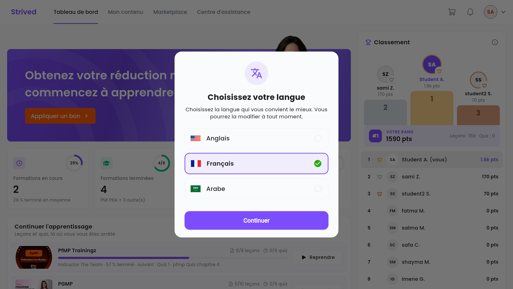
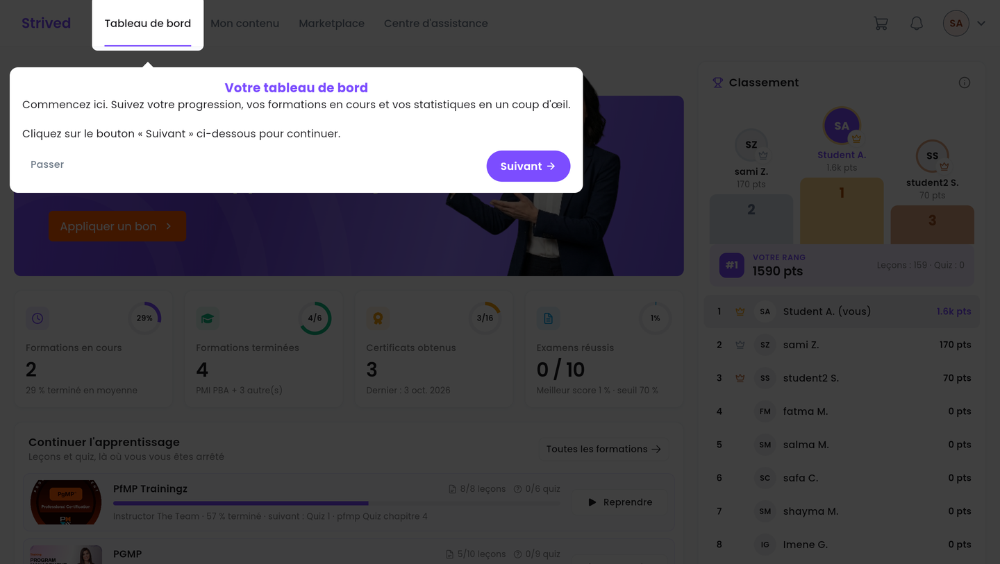
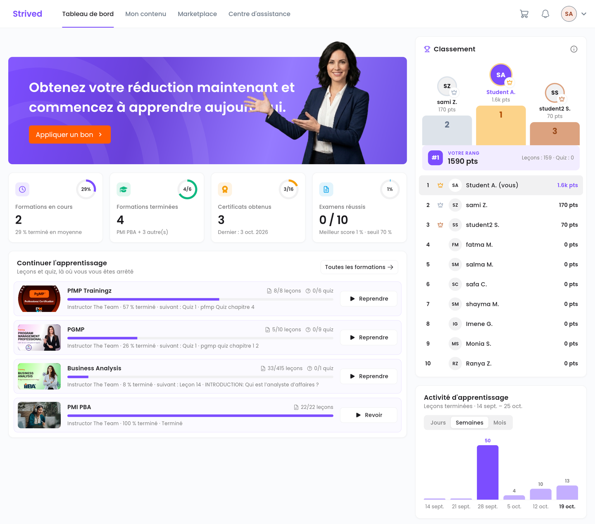
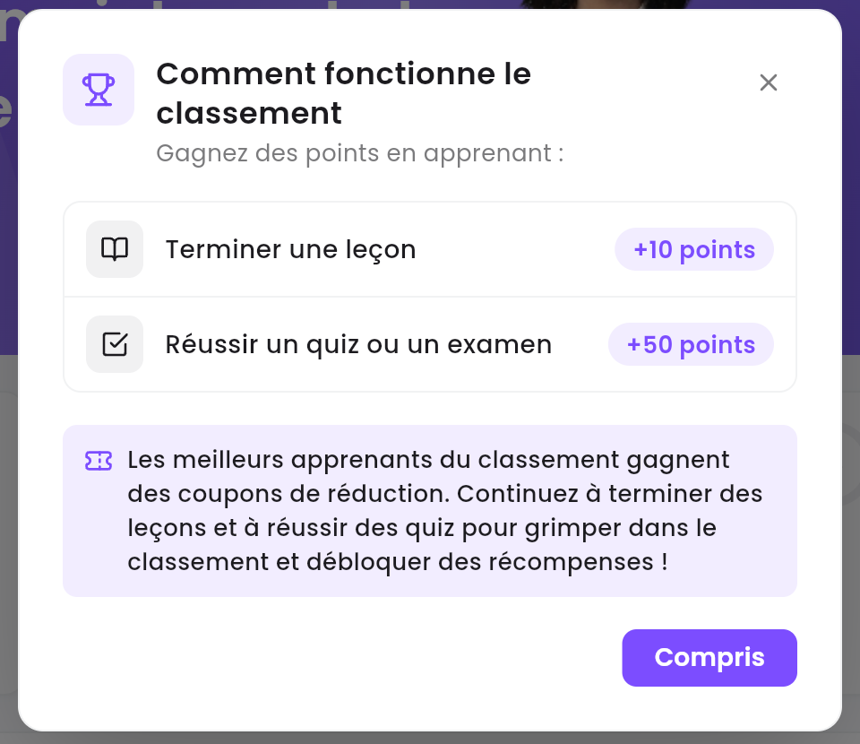

Ce guide vous accompagne lors de votre première connexion : choix de la langue, visite guidée de
l'application, puis lecture du **Tableau de bord**, la page qui s'ouvre après chaque connexion.

<Note>
  Tout ce qui suit concerne l'**application web** sur ordinateur. Sur votre écran, vous verrez vos
  propres formations, vos propres chiffres et votre propre classement.
</Note>

---

## Sommaire

- **Étape 1 — Se connecter**
- **Étape 2 — Choisir votre langue**
- **Étape 3 — Suivre la visite guidée**
- **Étape 4 — Lire votre tableau de bord**
- **Étape 5 — Gagner des points**
- **Bon à savoir**

---

## Étape 1 — Se connecter

<Steps>
  <Step title="Ouvrez la page de connexion">
    Le titre de la page est **Connectez-vous à votre compte**. L'icône de traduction en haut à
    droite du formulaire change la langue de la page avant même de vous connecter.
  </Step>
  <Step title="Saisissez vos identifiants">
    Renseignez votre **E-mail** et votre **Mot de passe**, puis cliquez sur **Se connecter**.
    Laissez **Se souvenir** coché pour rester connecté sur cet ordinateur.
  </Step>
</Steps>

<Tip>
  Mot de passe perdu ? Cliquez sur **Mot de passe oublié** sous le champ du mot de passe.
</Tip>

---

## Étape 2 — Choisir votre langue

À votre toute première connexion, la fenêtre **Choisissez votre langue** s'affiche. Sélectionnez
**Anglais**, **Français** ou **Arabe**, puis cliquez sur **Continuer**. Toute l'application, visite
guidée comprise, s'affiche alors dans cette langue.

<Frame caption="La fenêtre de choix de la langue, à la première connexion.">
  
</Frame>

---

## Étape 3 — Suivre la visite guidée

Une courte visite présente ensuite la barre du haut, élément par élément : **Tableau de bord**,
**Mon contenu**, **Marketplace** et **Centre d'assistance**. Cliquez sur **Suivant** pour avancer,
ou sur **Passer** pour l'arrêter.

<Frame caption="La visite guidée met en avant chaque élément de la barre du haut.">
  
</Frame>

Lors de votre première visite de **Mon contenu**, une seconde visite présente chacun de ses
onglets : **Mes formations**, **Mon simulateur d'examens**, **Classrooms & Chat**, **Certificats**
et **Tentatives d'examen**. Elle se termine par **J'ai compris**.

---

## Étape 4 — Lire votre tableau de bord

<Frame caption="Le tableau de bord : vos chiffres, vos formations en cours, le classement et votre activité.">
  
</Frame>

| Zone | Ce qu'elle vous montre |
| :-- | :-- |
| Bandeau **Appliquer un bon** | Saisir le voucher (bon) reçu par e-mail — voir [Utiliser un voucher](/student-guide/utiliser-un-voucher). |
| **Formations en cours** | Le nombre de formations commencées et leur avancement moyen. |
| **Formations terminées** | Les formations finies, sur le total que vous possédez. |
| **Certificats obtenus** | Vos certificats et la date du dernier. |
| **Examens réussis** | Les examens blancs réussis, votre meilleur score et le seuil de réussite. |
| **Continuer l'apprentissage** | Vos formations, avec la prochaine leçon ou le prochain quiz. **Reprendre** rouvre la formation là où vous vous êtes arrêté ; **Revoir** rouvre une formation terminée. |
| **Classement** | Les apprenants de votre organisation, classés par points, et **Votre rang**. |
| **Activité d'apprentissage** | Les leçons terminées par **Jours**, **Semaines** ou **Mois**. |

---

## Étape 5 — Gagner des points

Cliquez sur l'icône **ⓘ** du **Classement** pour voir comment les points sont calculés.

<Frame caption="Le calcul des points du classement.">
  
</Frame>

- **Terminer une leçon** : +10 points.
- **Réussir un quiz ou un examen** : +50 points.

Les meilleurs apprenants du classement gagnent des coupons de réduction, à utiliser dans le panier.

---

## Bon à savoir

<AccordionGroup>
  <Accordion title="Puis-je revoir la visite guidée ?">
    La visite ne s'affiche qu'une seule fois par compte sur un même navigateur. Les guides de
    cette rubrique et le **Centre d'assistance** restent disponibles à tout moment.
  </Accordion>
  <Accordion title="Comment changer de langue plus tard ?">
    Cliquez sur votre avatar en haut à droite, puis sur **Langues**. Voir
    [Gérer votre compte](/student-guide/gerer-son-compte).
  </Accordion>
  <Accordion title="Mon tableau de bord est vide">
    Vous ne possédez encore aucune formation. Si vous avez reçu un voucher (bon) par e-mail,
    saisissez-le avec **Appliquer un bon** — voir [Utiliser un voucher](/student-guide/utiliser-un-voucher).
    Sinon, parcourez la **Marketplace**.
  </Accordion>
</AccordionGroup>
