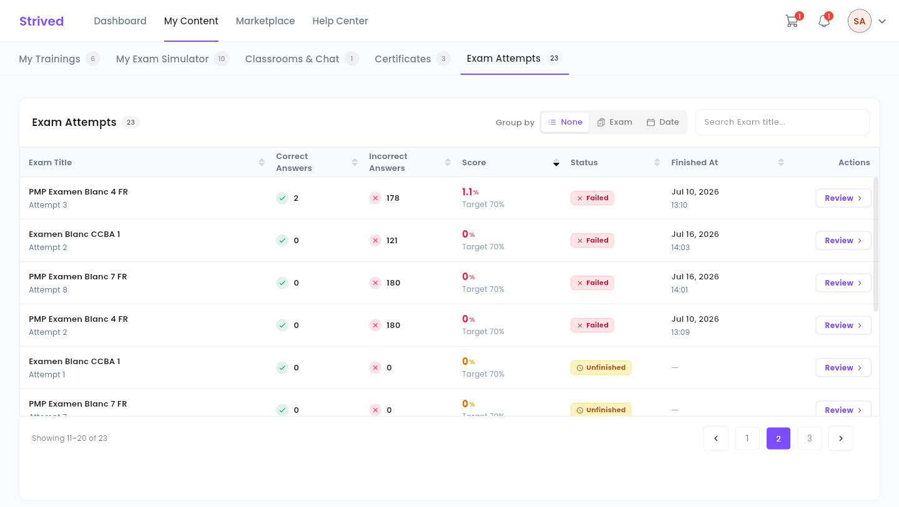
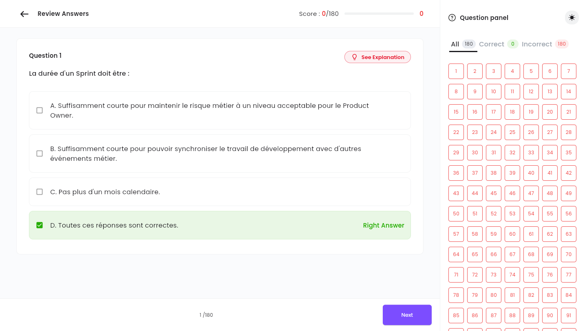

Every mock exam attempt is saved. This guide shows you where to find your attempts and how to read
the correction so you can improve.

<Note>
  Everything below is for the **web app** on a computer. You will see your own attempts and your
  own scores.
</Note>

---

## Table of contents

- **Step 1 — Open Exam Attempts**
- **Step 2 — Read the table**
- **Step 3 — Review the correction**
- **Good to know**

---

## Step 1 — Open Exam Attempts

Click **My Content** in the top bar, then the **Exam Attempts** tab (address
`/student-my-content/attempts`). The **See my attempts** button on an exam's page leads to the same
place.

<Frame caption="My Content → Exam Attempts: one attempt per row.">
  
</Frame>

---

## Step 2 — Read the table

| Column | Meaning |
| :-- | :-- |
| **Exam Title** | The mock exam, with the attempt number underneath (`Attempt 3`). |
| **Correct Answers** / **Incorrect Answers** | How many answers you got right and wrong. |
| **Score** | Your score, with the pass mark underneath, e.g. `1.1%` and `Target 70%`. |
| **Status** | **Passed** if you reached the pass mark, **Failed** if not, **Unfinished** for an attempt started but never submitted. |
| **Finished At** | The date and time you submitted, or `—` for an unfinished attempt. |
| **Actions** | **Review** opens the correction. |

<Tip>
  **Search Exam title…** filters the list, and the arrows in the headers sort it. The numbered
  buttons at the bottom change page (10 attempts per page).
</Tip>

**Group by** changes how the table is laid out:

- **None** — one long list, as above.
- **Exam** — your attempts gathered under each exam.
- **Date** — your attempts gathered by date.

In the **Exam** and **Date** views, click a group's header to fold or unfold it. The app remembers
your choice on this computer.

---

## Step 3 — Review the correction

Click **Review** on an attempt. The **Review Answers** screen opens:

<Frame caption="The correction of an attempt: the right answer is highlighted in green.">
  
</Frame>

- At the top: your **Score**, as right answers out of the total (for example `Score : 0/180`).
- In the middle: the question, with the **Right Answer** highlighted in green.
- **See Explanation** shows the instructor's comment on this question;
  **Back to answers' review** returns to the question.
- **Next** and **Previous** at the bottom move through the questions.
- On the right, the **Question panel** lists every number: green for a right answer, red for a
  wrong one. The **All**, **Correct** and **Incorrect** filters help you focus on your mistakes.

---

## Good to know

<AccordionGroup>
  <Accordion title="Why does an attempt show Unfinished and 0%?">
    The exam was started and then left, or the page was reloaded, without submitting. The attempt
    still counts toward the number of attempts used.
  </Accordion>
  <Accordion title="A question has no explanation">
    The instructor did not write one for this question: the screen then shows
    *"No explanation was provided"*.
  </Accordion>
  <Accordion title="How do I retake an exam?">
    Go back to **My Exam Simulator** and open the exam: the attempts chip shows how many you have
    left. See [Take a mock exam](/student-guide/take-a-mock-exam).
  </Accordion>
</AccordionGroup>
