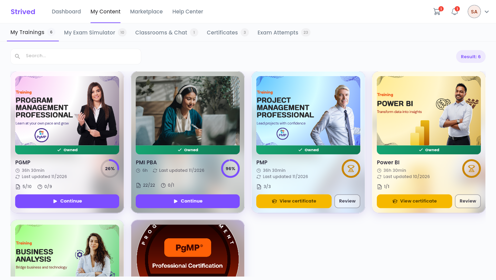
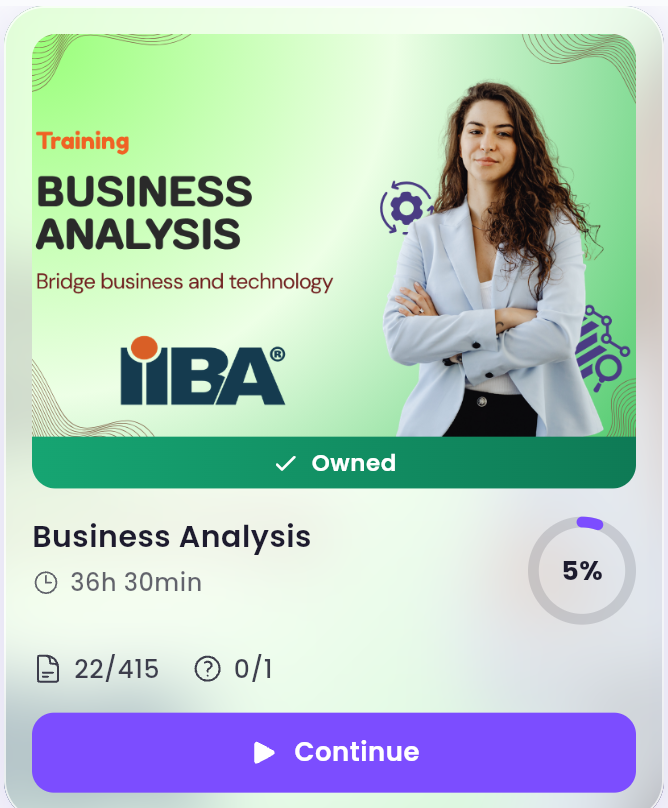
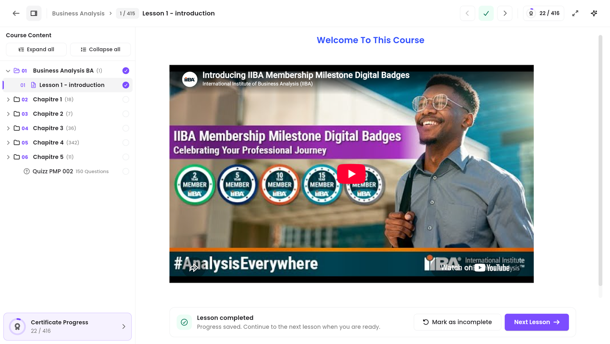
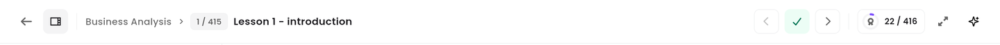
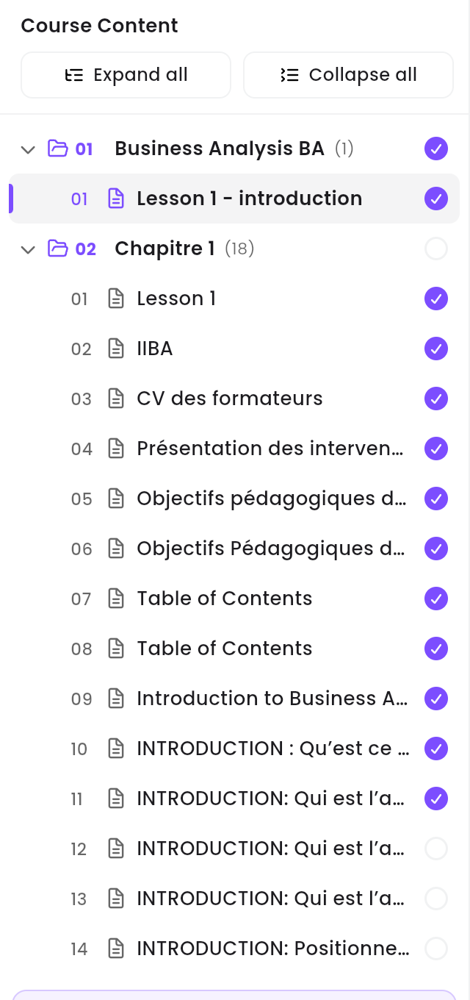
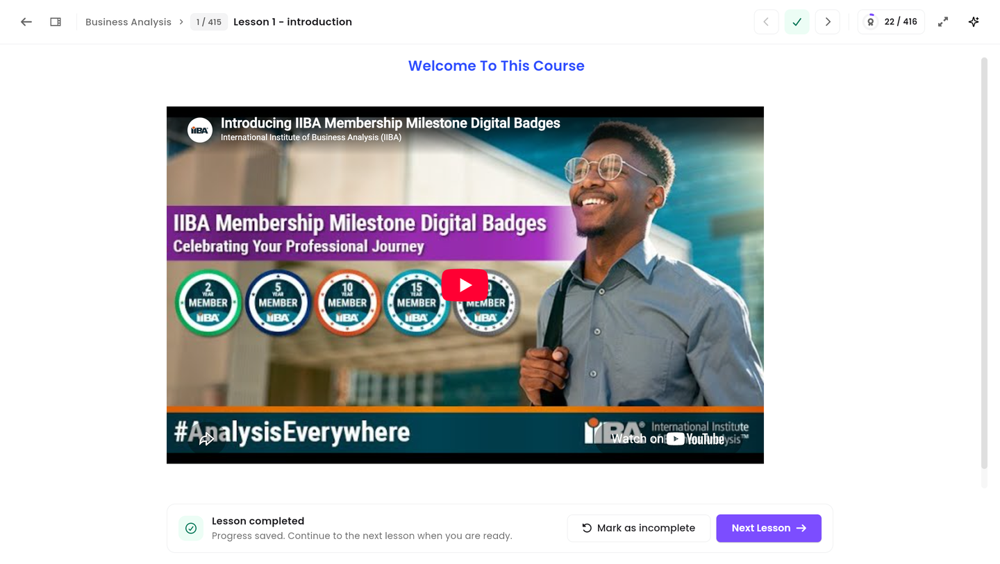
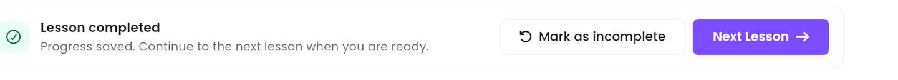
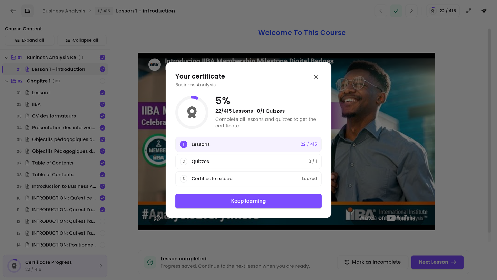

This guide shows you how to open one of your trainings in a web browser, study its lessons, and
move between them with the **Course Content** navigation panel.

<Note>
  Everything below is for the **web app** on a computer. The screenshots were taken on a real
  training, so what you see on your screen will show your own trainings and your own progress.
</Note>

---

## Table of contents

- **Step 1 — Open My Trainings**
- **Step 2 — Pick the training you want to study**
- **Step 3 — Find your way around the course player**
- **Step 4 — Move between lessons with the Course Content panel**
- **Step 5 — Study a lesson and mark it complete**
- **Step 6 — Follow your progress toward the certificate**
- **Good to know**

---

## Step 1 — Open My Trainings

<Steps>
  <Step title="Click My Content in the top bar">
    The dark bar at the very top of the page is the main menu: **Dashboard**, **My Content**,
    **Marketplace** and **Help Center**. Click **My Content**.
  </Step>
  <Step title="Stay on the My Trainings tab">
    A second row of tabs appears underneath: **My Trainings**, **My Exam Simulator**,
    **Classrooms & Chat**, **Certificates** and **Exam Attempts**. **My Trainings** is the first
    one and opens by default. The small grey number next to each tab tells you how many items it holds.
  </Step>
</Steps>

<Frame caption="My Content → My Trainings: every training you own, with its progress.">
  
</Frame>

The address bar reads `/student-my-content/trainings`. You can bookmark it to come back straight
to this page.

<Tip>
  Have a lot of trainings? Use the **Search…** box above the cards to filter them by name.
</Tip>

---

## Step 2 — Pick the training you want to study

Each training is a card. Here is what it tells you:

<Frame caption="A training card: cover, title, duration, progress and what is left to do.">
  
</Frame>

| On the card | What it means |
| :-- | :-- |
| Green **Owned** strip | You have access to this training. |
| Title | The name of the training, e.g. *Business Analysis*. |
| Clock, e.g. `36h 30min` | How long the whole training lasts. |
| Circle, e.g. `5%` | How much of it you have completed. |
| Page icon, e.g. `22/415` | Lessons you have completed, out of the total. |
| Question-mark icon, e.g. `0/1` | Quizzes you have passed, out of the total. |
| **Continue** | Opens the training where you left off. |

Click **Continue** to open the training.

<Note>
  When you have finished everything, **Continue** is replaced by **View certificate** and
  **Review**. **Review** reopens the lessons in read-only mode so you can go over them again.
</Note>

---

## Step 3 — Find your way around the course player

The training opens in the **course player**. Its address looks like
`/student-my-content/student-training-details/2`, where the number is the training's own id.

<Frame caption="The course player: navigation panel on the left, lesson in the middle, toolbar on top.">
  
</Frame>

The player has three parts:

1. **The toolbar** across the top — where you are, and the buttons to move around.
2. **The Course Content panel** on the left — the full list of chapters, lessons and quizzes.
3. **The lesson pane** in the middle — the lesson you are studying right now.

### The toolbar, button by button

<Frame caption="The course player toolbar.">
  
</Frame>

On a laptop screen most of these buttons are icons only. Hover over one to see its name.

| Button | What it does |
| :-- | :-- |
| **←** (far left) | **Back to My Trainings** — leaves the training. Your progress is already saved. |
| Panel icon (next to the arrow) | Shows or hides the **Course Content** panel. |
| `Business Analysis › 1 / 415 › Lesson 1 - introduction` | Where you are: the training, the lesson number out of the total, and the lesson title. |
| **‹** | **Previous Lesson**. |
| **✓** (green when the lesson is done) | Marks the lesson you are reading as complete, or undoes it. |
| **›** | **Next Lesson**. |
| Medal chip, e.g. `22 / 416` | Your progress toward the certificate — click it for the details. |
| Arrows icon | **Full Screen** — hides the rest of the page so only the lesson shows. |
| **✦** (far right) | **AI Assistant**. It is marked *Coming soon* and cannot answer yet. |

<Tip>
  On a wider screen the same buttons show their labels (**Mark as incomplete**, **Next**,
  **AI Assistant**). They behave exactly the same.
</Tip>

---

## Step 4 — Move between lessons with the Course Content panel

The left panel is how you navigate the training. It lists every **chapter**, and inside each
chapter every **lesson** and **quiz**, in the order the instructor set them.

<Frame caption="The Course Content panel, with a chapter opened.">
  
</Frame>

**How to use it:**

<Steps>
  <Step title="Open a chapter">
    Click a chapter row — for example `02 Chapitre 1 (18)`. It unfolds and shows the lessons it
    contains. The number in brackets is how many lessons are inside. Click the row again to fold
    it back.
  </Step>
  <Step title="Open a lesson">
    Click any lesson row. It opens straight away in the middle of the screen. You can jump to any
    lesson of the training at any time — nothing is locked once you own the training.
  </Step>
  <Step title="Open everything at once, or close it">
    **Expand all** unfolds every chapter, **Collapse all** folds them all back. Handy to get an
    overview of a long training.
  </Step>
</Steps>

### Reading the panel at a glance

| What you see | What it means |
| :-- | :-- |
| Purple circle with a check | Lesson completed. |
| Empty grey circle | Not completed yet. |
| Purple bar on the left of a row, grey background | The lesson you are reading right now. |
| Folder icon + `01`, `02`, … | A chapter, in order. |
| Page icon + `01`, `02`, … | A lesson, in order inside its chapter. |
| Question-mark icon, e.g. `Quizz PMP 002 · 150 Questions` | A quiz. Click it to start or review it. |
| **Certificate Progress** at the bottom | Your progress toward the certificate. |

### Give the lesson more room

Click the panel icon in the toolbar (just right of the back arrow) to hide the Course Content
panel. The lesson then takes the whole width. Click it again to bring the panel back.

<Frame caption="The same lesson with the Course Content panel hidden.">
  
</Frame>

---

## Step 5 — Study a lesson and mark it complete

Read, watch or scroll through the lesson in the middle of the screen. A lesson can hold text,
images, videos and PDF documents — use the player controls inside a video as usual.

When you are done, use the bar at the bottom of the lesson:

<Frame caption="The bar below a lesson you have already completed.">
  
</Frame>

- **Lesson not finished yet** — the bar asks *"Finished this lesson?"* with
  *"Mark it as complete to save your progress and move on."* Click
  **Mark as complete and continue**: it saves your progress **and** opens the next lesson.
- **Lesson already finished** — the bar shows *"Lesson completed"* and
  *"Progress saved. Continue to the next lesson when you are ready."* Click **Next Lesson** to
  carry on, or **Mark as incomplete** if you marked it by mistake.

<Callout type="info">
  Your progress is saved on the spot, on the server. You can close the browser and pick the
  training back up later, on any computer, exactly where you stopped.
</Callout>

---

## Step 6 — Follow your progress toward the certificate

Click the medal chip in the toolbar, or **Certificate Progress** at the bottom of the Course
Content panel.

<Frame caption="The certificate progress window.">
  
</Frame>

It shows three conditions, in order:

1. **Lessons** — how many you have completed out of the total.
2. **Quizzes** — how many you have passed out of the total.
3. **Certificate issued** — stays **Locked** until the first two are complete.

Once everything is done, the button in this window lets you claim your certificate. You will then
find it under **My Content → Certificates** — see
[Get and share your certificates](/student-guide/get-your-certificates). Until then, the button reads
**Keep learning** and simply closes the window.

---

## Good to know

<AccordionGroup>
  <Accordion title="Do I have to finish the lessons in order?">
    No. Once a training is yours, every lesson of every chapter is open. Click any of them in the
    Course Content panel. The order only matters for the certificate: it needs **all** of the
    lessons and quizzes, whichever way round you do them.
  </Accordion>
  <Accordion title="I closed the training — do I lose my place?">
    No. Go back to **My Content → My Trainings** and click **Continue** on the card: the training
    reopens where you left off.
  </Accordion>
  <Accordion title="A video will not play">
    Check your internet connection first, then reload the page. If it still will not play, use
    **Help Center** in the top bar to get in touch with support.
  </Accordion>
  <Accordion title="Can I change the language of the app?">
    Yes. Click your avatar at the top right, then **Languages**. English, French and Arabic are
    available. The whole app, this training included, switches over. See
    [Manage your account](/student-guide/manage-your-account).
  </Accordion>
</AccordionGroup>
