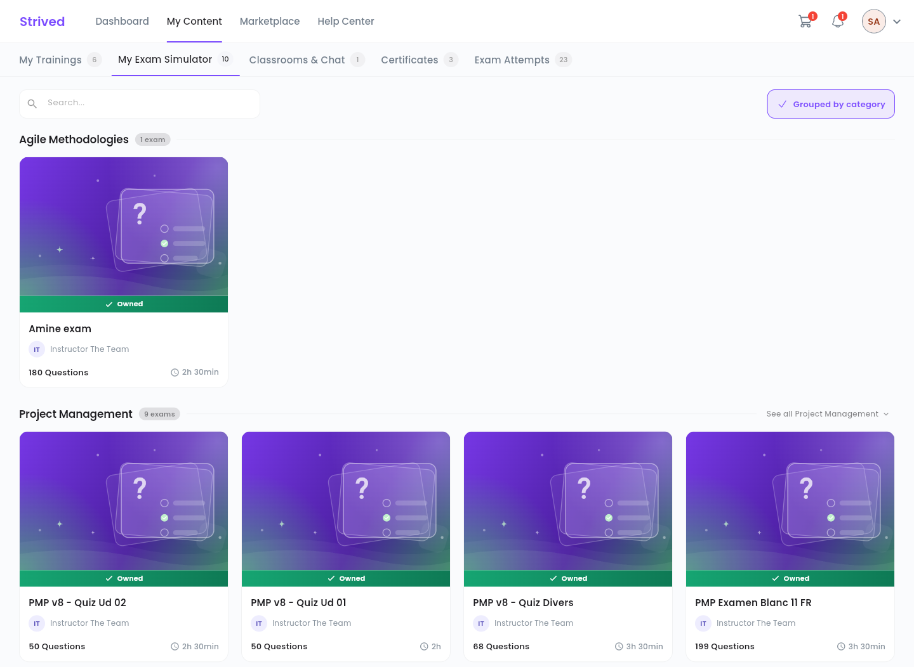
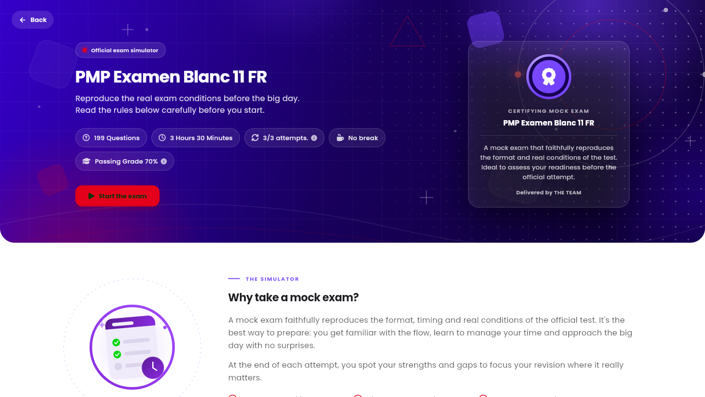
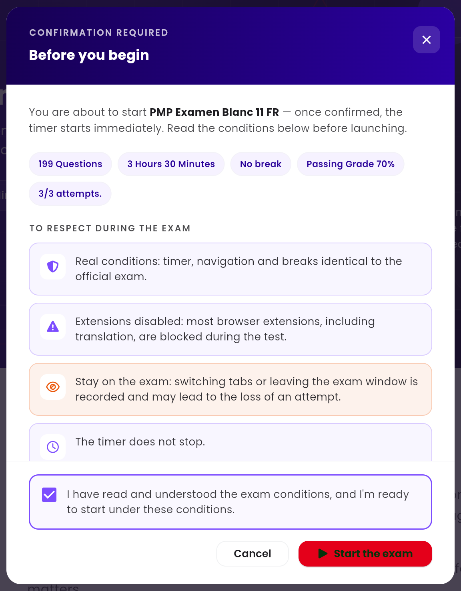

The **exam simulator** reproduces the real conditions of a certification exam (the PMP, for
example): same timer, same number of questions, same pass mark. This guide shows you how to take a
mock exam from start to finish.

<Note>
  Everything below is for the **web app** on a computer. You will see your own exams.
</Note>

---

## Table of contents

- **Step 1 — Open My Exam Simulator**
- **Step 2 — Read the exam page**
- **Step 3 — Confirm and start**
- **Step 4 — Answer the questions**
- **Step 5 — Submit and see your score**
- **Good to know**

---

## Step 1 — Open My Exam Simulator

In the top bar, click **My Content**, then the **My Exam Simulator** tab (address
`/student-my-content/exams`). Your exams are grouped by category; each card shows the exam title,
its instructor, the number of questions and the duration. Click a card to open it.

<Frame caption="My Content → My Exam Simulator: the mock exams you own, grouped by category.">
  
</Frame>

<Tip>
  The **Search…** box filters the exams by name. **Grouped by category** at the top right switches
  between the grouped view and a single list. When a category holds more exams than one row,
  **See all** opens the rest.
</Tip>

---

## Step 2 — Read the exam page

<Frame caption="The page of a mock exam, before you start it.">
  
</Frame>

The chips under the title sum up the rules:

| Chip | Meaning |
| :-- | :-- |
| `199 Questions` | The number of questions. |
| `3 Hours 30 Minutes` | The time you have. |
| `3/3 attempts.` | The attempts you have **left**, out of the total allowed. |
| **No break** | The exam has no scheduled break. Otherwise, the chip shows the planned break. |
| `Passing Grade 70%` | The minimum score to pass. |

Further down, **Why take a mock exam?** explains the simulator, the **Exam conditions** section
details the rules, and **See my attempts** opens the history of your attempts.

---

## Step 3 — Confirm and start

Click **Start the exam**. The **Before you begin** window recalls the conditions:

<Frame caption="The confirmation window before the exam starts.">
  
</Frame>

<Steps>
  <Step title="Read the conditions">
    Timer, navigation and breaks identical to the official exam; browser extensions (translation
    included) disabled; you must stay on the exam page; the timer does not stop.
  </Step>
  <Step title="Tick the confirmation box">
    *"I have read and understood the exam conditions, and I'm ready to start under these
    conditions."*
  </Step>
  <Step title="Click Start the exam">
    A short countdown shows, then the first question appears and the timer starts.
  </Step>
</Steps>

<Warning>
  Every start uses one attempt, even if you never submit your answers. Once your attempts are used
  up, a new purchase is required.
</Warning>

---

## Step 4 — Answer the questions

The exam screen has three areas:

| Area | What it does |
| :-- | :-- |
| Top bar | The exam title and the **time left**. |
| Centre | The current question and its answers. The bookmark icon (**Bookmark this question**) sets it aside so you can come back to it. **Previous** and **Next** at the bottom change question. |
| **Question panel** (right) | Every question number, with the **All**, **Answered** and **Bookmarked** filters. Click a number to go to it. **Hide sidebar** gives you more room. |

<Note>
  If the exam has breaks, you can only move between the questions you have already reached: the
  next ones unlock after the break.
</Note>

---

## Step 5 — Submit and see your score

Click **Submit** at the bottom of the **Question panel**. If some questions are still bookmarked,
the app tells you so you can check them first. When the time runs out, your answers are submitted
automatically.

The **Review Answers** screen then opens with your score and the correction of every question —
see [Review your exam attempts](/student-guide/review-your-exam-attempts). **Retry** starts a new
attempt if you have any left.

---

## Good to know

<AccordionGroup>
  <Accordion title="Can I reload the page during the exam?">
    No. Reloading or leaving the page stops the exam and your answers are **not** submitted. To
    stop on purpose, use **Quit Exam**.
  </Accordion>
  <Accordion title="I have no attempts left">
    The chip shows `0/3 attempts.` Contact support from the **Help Center** if you need to take
    the exam again.
  </Accordion>
  <Accordion title="Why does my browser's translation not work?">
    As on the day of the official exam, most browser extensions, translation tools included, are
    disabled during the exam.
  </Accordion>
  <Accordion title="Where can I find new mock exams?">
    In **Marketplace → Exam Catalog** — see
    [Buy a training or an exam](/student-guide/buy-a-training).
  </Accordion>
</AccordionGroup>
