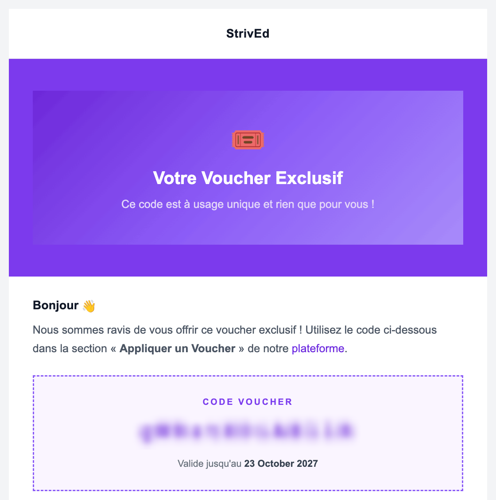
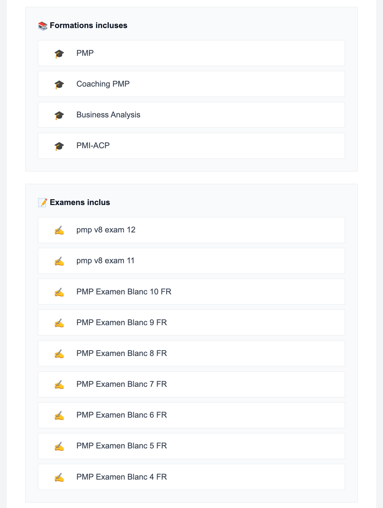
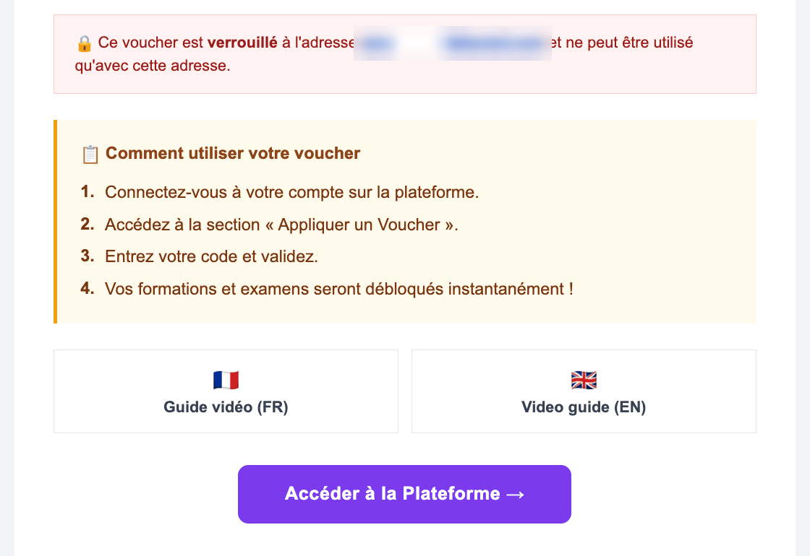
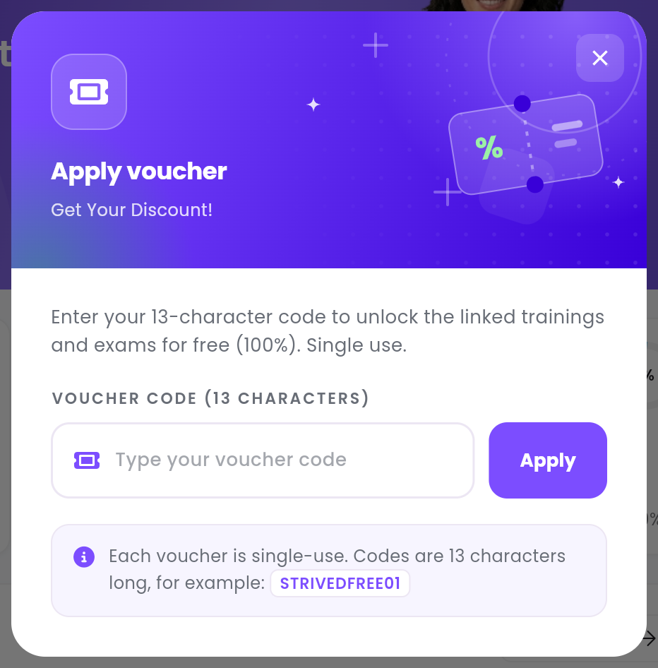

A **voucher** is a code that unlocks a set of trainings and mock exams **for free**. You get one,
for example, when you follow a training in person or in a hybrid format, or when your company
signs you up on the platform.

<Note>
  Do not mix up **voucher** and **coupon**. A coupon gives a discount on an order, in the cart —
  see [Buy a training or an exam](/student-guide/buy-a-training). A voucher gives you the content
  straight away: no cart, nothing to pay.
</Note>

---

## Table of contents

- **Step 1 — Find your voucher in your e-mails**
- **Step 2 — Check what it includes**
- **Step 3 — Open the Apply voucher window**
- **Step 4 — Enter the code**
- **Step 5 — Find your trainings and exams**
- **Good to know**

---

## Step 1 — Find your voucher in your e-mails

Your voucher is sent to you **by e-mail**, by StrivEd, with the subject **Your Voucher Details**.

<Callout type="info">
  The body of the voucher e-mail is written in **French**, whatever language you use in the app.
  The screenshots below show it as you will receive it; the tables explain each part in English.
</Callout>

The 13-character code sits in the **CODE VOUCHER** box, with its expiry date
(*Valide jusqu'au* means "valid until").

<Frame caption="The voucher e-mail. The code is hidden on this screenshot.">
  
</Frame>

<Tip>
  Cannot find the e-mail? Look in your **Spam** or **Junk** folder, then ask your instructor or
  your company to send it again.
</Tip>

---

## Step 2 — Check what it includes

Further down, the e-mail lists the trainings and exams the voucher unlocks:

<Frame caption="The content the voucher unlocks.">
  
</Frame>

Below that come the lock notice, the instructions and a button to the platform:

<Frame caption="The voucher lock and its instructions. The address is hidden on this screenshot.">
  
</Frame>

| In the e-mail (French) | What it means |
| :-- | :-- |
| **Formations incluses** | The trainings included. |
| **Examens inclus** | The mock exams included. |
| Red box *Ce voucher est verrouillé à l'adresse …* | The voucher is **locked** to this e-mail address: you must log in with that account. The box only appears on a locked voucher. |
| **Comment utiliser votre voucher** | How to use your voucher: the same steps as this guide. |
| **Video guide (EN)** / **Guide vidéo (FR)** | A video version of these steps, in English or in French. |
| **Accéder à la Plateforme** | Opens the platform. |

---

## Step 3 — Open the Apply voucher window

Log in with the e-mail address that received the voucher, then open the **Apply voucher** window:

- from the **Dashboard**: the **Apply voucher** button in the purple banner;
- or, while you do not own any training or exam yet, with the **Redeem voucher** button at the
  top of the screen.

---

## Step 4 — Enter the code

<Frame caption="The Apply voucher window.">
  
</Frame>

<Steps>
  <Step title="Paste the code">
    Copy the code from the e-mail and paste it into **Type your voucher code**. It must be exactly
    13 characters long.
  </Step>
  <Step title="Click Apply">
    The message **Voucher has been applied successfully** confirms that your content is unlocked.
  </Step>
  <Step title="Click Refresh this page">
    The app updates with your new trainings and exams.
  </Step>
</Steps>

<Tip>
  Copy and paste rather than typing: by hand, the letters `l`, `I` and the digit `1` are easy to
  mix up.
</Tip>

---

## Step 5 — Find your trainings and exams

| Content | Where to find it |
| :-- | :-- |
| Trainings | **My Content → My Trainings** — see [Follow a training](/student-guide/study-a-training). |
| Mock exams | **My Content → My Exam Simulator** — see [Take a mock exam](/student-guide/take-a-mock-exam). |

---

## Good to know

<AccordionGroup>
  <Accordion title="The code is refused: what does the message mean?">

    | Message | What to do |
    | :-- | :-- |
    | `Invalid voucher code.` | The code is wrong: copy it again from the e-mail. |
    | `Voucher is locked to …` | You are logged in with another account: log in again with the address that received the voucher. |
    | `Voucher has expired.` | The expiry date has passed: ask for a new voucher. |
    | `Voucher has already been used.` | The voucher has already been redeemed: it only works once. |
    | `Too many failed attempts…` | Three wrong codes in a row: wait a minute before trying again. |

  </Accordion>
  <Accordion title="I already own part of the content">
    What you already own stays as it is: the voucher only adds the trainings and exams you are
    missing.
  </Accordion>
  <Accordion title="Can I give my voucher to someone else?">
    No. A voucher only works once, and it is usually locked to the e-mail address that received
    it.
  </Accordion>
</AccordionGroup>
