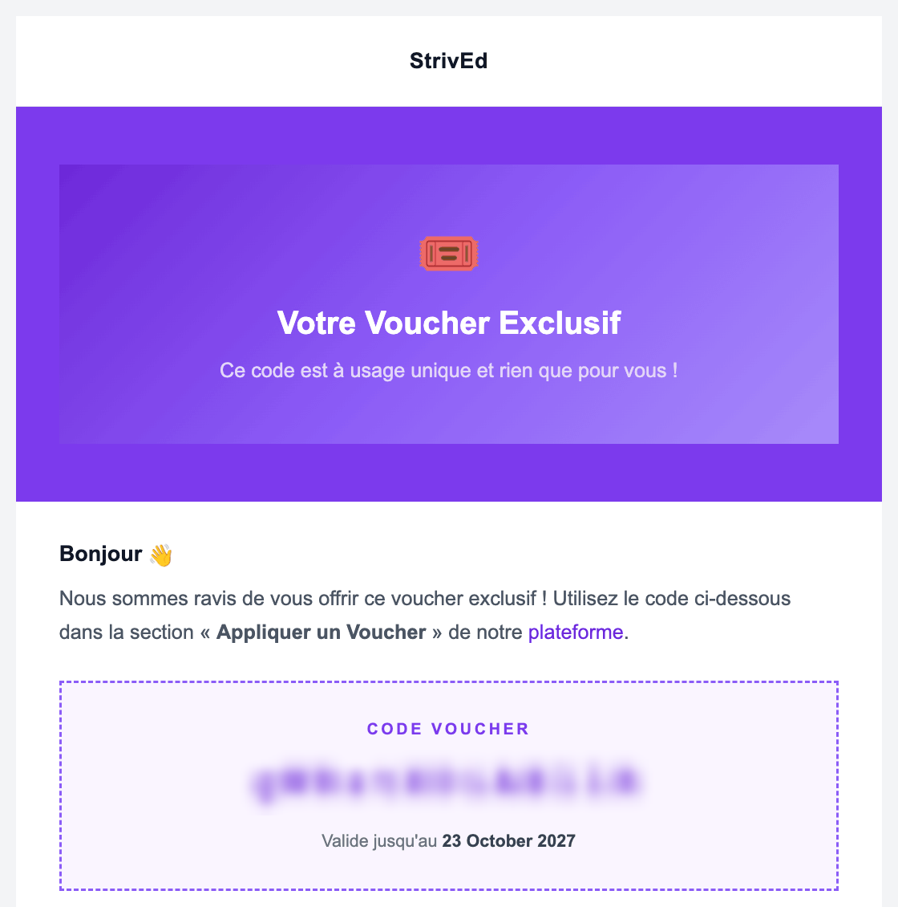
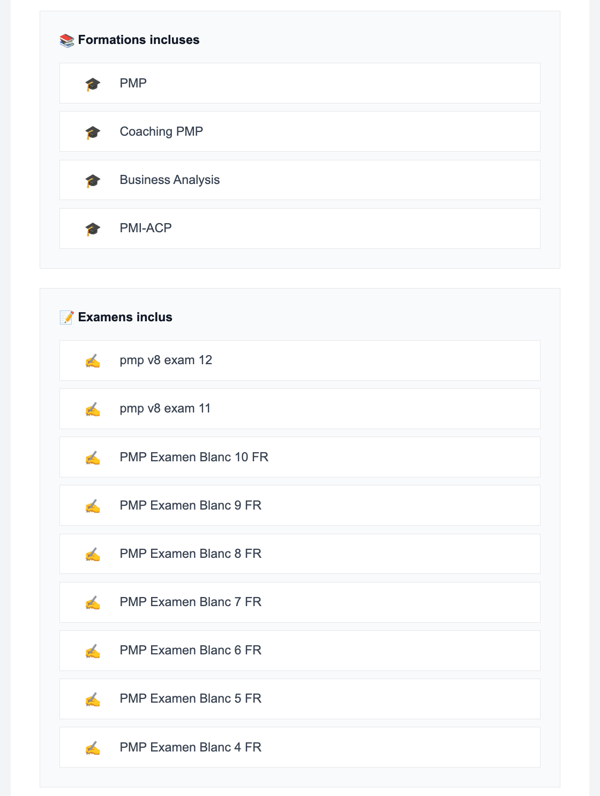
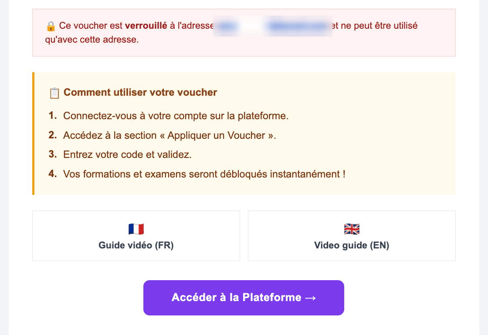
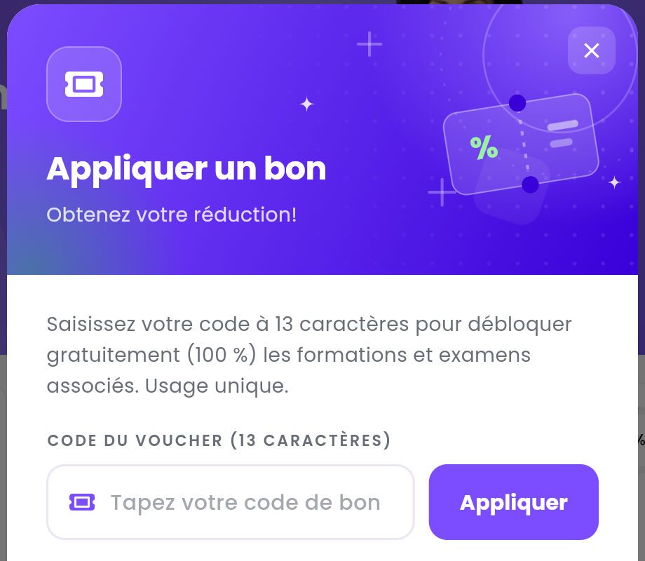

Un **voucher** (ou **bon**) est un code qui débloque **gratuitement** un ensemble de formations et
d'examens blancs. Vous en recevez un, par exemple, si vous suivez une formation en présentiel ou
en hybride, ou si votre entreprise vous inscrit sur la plateforme.

<Note>
  Ne confondez pas **voucher** et **coupon**. Un coupon donne une réduction sur une commande, dans
  le panier — voir [Acheter une formation ou un examen](/student-guide/acheter-une-formation). Un
  voucher donne directement accès au contenu : pas de panier, rien à payer.
</Note>

---

## Sommaire

- **Étape 1 — Retrouver votre voucher dans vos e-mails**
- **Étape 2 — Vérifier ce qu'il contient**
- **Étape 3 — Ouvrir la fenêtre Appliquer un bon**
- **Étape 4 — Saisir le code**
- **Étape 5 — Retrouver vos formations et examens**
- **Bon à savoir**

---

## Étape 1 — Retrouver votre voucher dans vos e-mails

Votre voucher vous est envoyé **par e-mail**, par StrivEd, avec l'objet **Your Voucher Details**.
Le code de 13 caractères se trouve dans le cadre **CODE VOUCHER**, avec sa date de validité.

<Frame caption="L'e-mail du voucher. Le code est masqué sur cette capture.">
  
</Frame>

<Tip>
  Vous ne trouvez pas l'e-mail ? Regardez dans le dossier **Spam** ou **Courrier indésirable**, puis
  demandez à votre formateur ou à votre entreprise de vous le renvoyer.
</Tip>

---

## Étape 2 — Vérifier ce qu'il contient

Plus bas, l'e-mail liste les **Formations incluses** et les **Examens inclus** : c'est exactement ce
que le voucher va débloquer.

<Frame caption="Le contenu débloqué par le voucher.">
  
</Frame>

Le cadre rouge, quand il est présent, indique l'adresse e-mail à laquelle le voucher est
**verrouillé** : vous devez vous connecter avec ce compte-là. En dessous, l'e-mail rappelle le mode d'emploi et propose deux guides
vidéo (FR et EN) ainsi que le bouton **Accéder à la Plateforme**.

<Frame caption="Le verrouillage du voucher et son mode d'emploi. L'adresse est masquée sur cette capture.">
  
</Frame>

---

## Étape 3 — Ouvrir la fenêtre Appliquer un bon

Connectez-vous avec l'adresse e-mail qui a reçu le voucher, puis ouvrez la fenêtre
**Appliquer un bon** :

- depuis le **Tableau de bord** : bouton **Appliquer un bon** dans le bandeau violet ;
- ou, tant que vous ne possédez encore aucune formation ni aucun examen, avec le bouton
  **Utiliser un bon** en haut de l'écran.

---

## Étape 4 — Saisir le code

<Frame caption="La fenêtre Appliquer un bon.">
  
</Frame>

<Steps>
  <Step title="Collez le code">
    Copiez le code depuis l'e-mail et collez-le dans **Tapez votre code de bon**. Il doit faire
    exactement 13 caractères.
  </Step>
  <Step title="Cliquez sur Appliquer">
    Le message **Bon appliqué avec succès** confirme que votre contenu est débloqué.
  </Step>
  <Step title="Cliquez sur Actualiser cette page">
    L'application se met à jour avec vos nouvelles formations et vos nouveaux examens.
  </Step>
</Steps>

<Tip>
  Préférez le copier-coller : à la main, les lettres `l`, `I` et le chiffre `1` se confondent
  facilement.
</Tip>

---

## Étape 5 — Retrouver vos formations et examens

| Contenu | Où le trouver |
| :-- | :-- |
| Formations | **Mon contenu → Mes formations** — voir [Suivre une formation](/student-guide/suivre-une-formation). |
| Examens blancs | **Mon contenu → Mon simulateur d'examens** — voir [Passer un examen blanc](/student-guide/passer-un-examen-blanc). |

---

## Bon à savoir

<AccordionGroup>
  <Accordion title="Le code est refusé : que signifie le message ?">

    | Message | Ce qu'il faut faire |
    | :-- | :-- |
    | `Invalid voucher code.` | Le code est erroné : recopiez-le depuis l'e-mail. |
    | `Voucher locked to …` | Vous êtes connecté avec un autre compte : reconnectez-vous avec l'adresse qui a reçu le voucher. |
    | `Voucher expired.` | La date de validité est dépassée : demandez un nouveau voucher. |
    | `Voucher already used.` | Le voucher a déjà été utilisé : il ne sert qu'une fois. |
    | `Too many failed attempts…` | Trois codes erronés de suite : patientez une minute avant de réessayer. |

  </Accordion>
  <Accordion title="Je possède déjà une partie du contenu">
    Ce que vous possédez déjà reste inchangé : le voucher n'ajoute que les formations et examens qui
    vous manquent.
  </Accordion>
  <Accordion title="Puis-je donner mon voucher à quelqu'un ?">
    Non. Un voucher ne sert qu'une seule fois, et il est généralement verrouillé à l'adresse e-mail
    qui l'a reçu.
  </Accordion>
</AccordionGroup>
